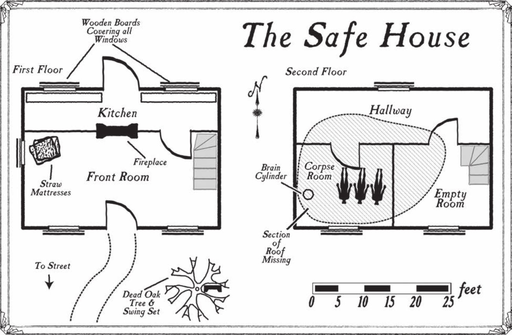

## План дома-убежища

*Надписи плана в переводе:* «Дом-убежище». Первый этаж: деревянные доски на всех окнах; кухня; камин; большая комната; соломенные тюфяки. Второй этаж: коридор; мозговой цилиндр; комната с трупами; пустая комната; здесь нет части крыши. Снаружи: к дороге; засохший дуб и качели. Масштаб в футах: 0–25 футов (около 8 м).

кухню — справа от него. Рядом — лестница на второй этаж. Если войти сзади, сыщики оказываются на кухне, знавшей лучшие дни. Она пропахла гнилой едой, деревянные столешницы просели и завалены ржавыми консервными банками. Внизу никаких признаков жизни, поэтому сыщики, вероятно, захотят проверить второй этаж.

Каким бы путём они ни вошли, дом полон жуткой тишины — будто внутри годами никого не было. Тишина держится ещё несколько секунд после того, как они входят в большую комнату, пока вдруг громкий стук сверху не стряхивает пыль со стропил. Звук такой, словно наверху бьют копытами лошади.

Поднявшись по лестнице, сыщики оказываются в коридоре с заплесневелой штукатуркой на стенах. Слева две двери, справа заколоченное окно. Как только первый сыщик ступает на верхнюю ступеньку, топот прекращается. На пару секунд возвращается жуткая тишина, пока из второй двери справа не раздаётся громкий грохот. Дверь открывается лишь на несколько сантиметров: что-то подпирает её с другой стороны (встречная проверка СИЛ против СИЛ 40, чтобы открыть дверь силой). Если дверь открыть, сыщики могут пожалеть, что не оставили всё как есть. На полу расстелена большая белая простыня в пятнах крови, освещённая звёздами: в этой части дома нет крыши. На простыне ровным рядом лежат тела агентов (кроме трупа, подпиравшего дверь). Верхушек голов у них нет — их аккуратно срезали над скальпом; потребуйте проверку Рассудка (потеря 1/1d6).

Как только сыщики входят в комнату, они слышат пчелиное жужжание и громкие хлопки крыльев. Взглянув вверх между сломанными стропилами, они видят шесть (или больше, если пожелает Хранитель) неземных, похожих на ракообразных силуэтов на фоне звёздного неба. Существа улетают на толстых перепончатых крыльях. Это зрелище вызывает ещё одну проверку Рассудка (потеря 0/1d6).

Как только агенты поднялись на второй этаж, ми-го с хирургической точностью извлекли их мозги и поместили в мозговые цилиндры. Вместе с книгами, рудой и исследовательскими записями пришельцы взмыли в небо, направляясь к своей базе. Когда агенты и ми-го исчезли, сыщики могут захотеть обыскать дом.

Во-первых, при более внимательном осмотре тел видно, что у них нет мозгов (проверка Рассудка, потеря 0/1d3). Во-вторых, в спешке ми-го оставили запасной мозговой цилиндр и кое-какие другие любопытные вещи. Рядом с одним из трупов можно найти звуковой излучатель (с. 13, раздел «Инструменты ми-го» в главе «Предыстория кампании»), а возле него лежит нечто похожее на огромную металлическую ложку для мороженого; край ложки зазубрен острыми крошечными шипами (ею извлекали мозги). Кроме зловещей инопланетной техники и безмозглых трупов, комната пуста. Если сыщики захотят проверить другую спальню, они найдут изъеденный жучком комод и три сложенных друг на друга заплесневелых тюфяка.

*Примечание:* в необязательной сцене «Ещё одна ловушка?» (с. 21) агенты ми-го могли захватить одного или нескольких сыщиков; если так, их держат в этом доме, пока им не удастся бежать, их не спасут другие сыщики или их не увезут ми-го (на усмотрение Хранителя).
