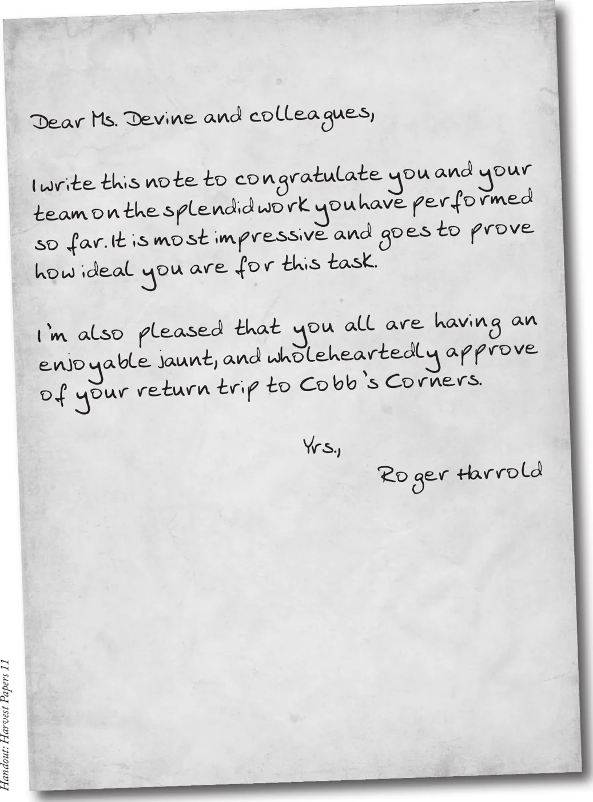

**Раздатка «Жатва» 12** — записка Харролда Дафне Девайн; перевод — с. 20.

*Прим. перев.: в собранных раздатках подписи перепутаны — эта записка подписана «Harvest Papers 11», а письмо Эмельды Кратчетт на с. 45 — «Harvest Papers 12»; в главе (с. 19–20) номера наоборот, и перевод следует главе.*
