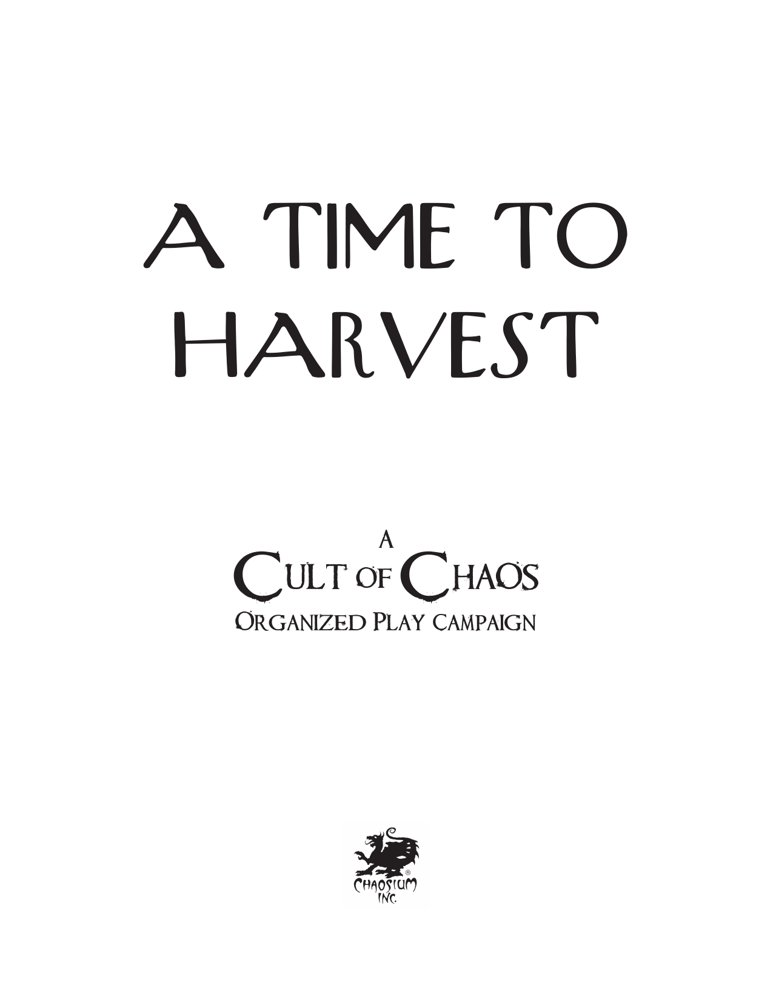

ВРЕМЯ ЖАТВЫ

Кампания организованной игры «Культ Хаоса»

*На обложке — название «A Time to Harvest» («Время жатвы»), подпись «A Cult of Chaos Organized Play Campaign» («Кампания организованной игры „Культ Хаоса“») и эмблема Chaosium (дракон).*
