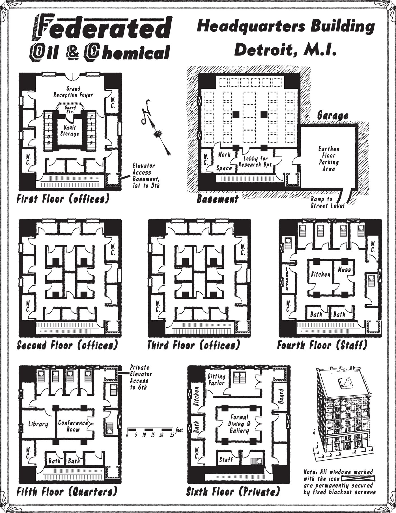

## План штаб-квартиры «Федерейтед Ойл энд Кемикал»

**Подписи на плане.** Заголовок: «Federated Oil & Chemical — Headquarters Building, Detroit, M.I.» («Федерейтед Ойл энд Кемикал» — здание штаб-квартиры, Детройт, штат Мичиган).

| Подпись на плане | Перевод |
|---|---|
| First Floor (offices) | Первый этаж (конторы) |
| Grand Reception Foyer | Парадное фойе |
| Guard Stn. | Пост охраны |
| Vault Storage | Хранилище |
| Files | Архив |
| W.C. | Уборная |
| Elevator Access Basement, 1st to 5th | Лифт: подвал, с первого по пятый этаж |
| Basement | Подвал |
| Work Space | Рабочее пространство |
| Lobby for Research Dpt. | Вестибюль исследовательского отдела |
| Garage | Гараж |
| Earthen Floor Parking Area | Стоянка с земляным полом |
| Ramp to Street Level | Пандус на улицу |
| Second Floor (offices) | Второй этаж (конторы) |
| Third Floor (offices) | Третий этаж (конторы) |
| Fourth Floor (Staff) | Четвёртый этаж (прислуга) |
| Kitchen | Кухня |
| Mess | Столовая |
| Laundry | Прачечная |
| Bath | Ванная |
| Fifth Floor (Quarters) | Пятый этаж (жилые комнаты) |
| Library | Библиотека |
| Conference Room | Конференц-зал |
| Private Elevator Access to 6th | Частный лифт на шестой этаж |
| Sixth Floor (Private) | Шестой этаж (личные покои) |
| Sitting Parlor | Гостиная |
| Guard | Караульная |
| Formal Dining & Gallery | Парадная столовая и галерея |
| Staff | Комната прислуги |
| Note: All windows marked with the icon are permanently secured by fixed blackout screens | Примечание: все окна, отмеченные значком, намертво закрыты закреплёнными светомаскировочными щитами |

Масштабная линейка — в футах: 0–25 футов (около 8 м).
