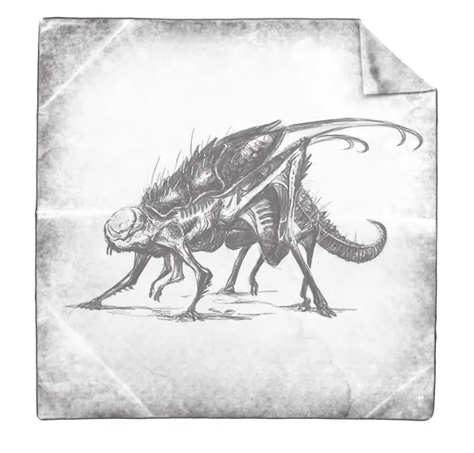

первой стоит стальной смотровой стол с несколькими кожаными ремнями. Рядом на полу — электрический генератор. Во второй клетке люди, по-видимому, изучают два мумифицированных тела. Учёные осторожно извлекают из двух трупов высохшие органы, а позади них лежат ещё восемь (пока нетронутых) мумифицированных тел. Каждое погружено в бак с водой. Любопытных сыщиков Мэтерсон уводит прочь, потянувшись задёрнуть занавесь. Если на неё надавить, доктор объясняет, что останки недавно нашли в Андах, на будто бы заброшенной базе ми-го. Мэтерсон объясняет, что, по их мнению, мумии — ещё не виданная форма ми-го, возможно созданная, чтобы подражать человеческой внешности. Хотя как следует разглядеть, что там происходит, сыщикам не удаётся, увиденное требует проверки Рассудка (потеря 0/1d4).

**Примечание:** на самом деле мумифицированные тела — глубоководные. Подробнее — в разделе «Неожиданные последствия» (с. 16).

В третьей клетке лежат вещи, найденные вместе с мумифицированными останками (глубоководных): охотничьи копья, обсидиановые ножи, грубо выкованные золотые украшения и зеленовато-чёрная скрижаль (см. врезку рядом, «Андская скрижаль»). Мэтерсон объясняет, что для разбора неизвестного языка, высеченного на камне, собирают команду лучших криптографов страны.

> **Книга Мифов**
>
> **Андская скрижаль**
>
> *Р’льехские глифы, автор неизвестен*
>
> - Потеря Рассудка: 1d6
> - Мифы Ктулху: +0%/+2%
> - Значение Мифов: 6%
> - Изучение: 12 недель
> - Заклинания: Связь с божеством: Ктулху
>
> Скрижаль вырезана из необычного зеленовато-чёрного камня; успешная проверка Науки (геологии) позволяет определить, что он внеземного происхождения. На поверхности вырезаны странные символы и знаки ни на одном известном человеческом языке (р’льехские глифы). Кроме того, в центре высечено грубое изображение человекоподобной фигуры: она сидит сгорбившись, расправив крылья и положив огромные когтистые руки на колени. Голова фигуры похожа на осьминога, и от неё веет мрачной злобой.
>
> Расшифрованная скрижаль оказывается, по сути, средством для медитации, созданным, чтобы помогать глубоководным общаться со своим богом. Текст повествует о приходе Ктулху и его сородичей из внешнего космоса и о славе грядущего возвращения бога.

Мэтерсон ведёт сыщиков туда, где стоят фонограф и стулья. Она объясняет, что сейчас они услышат запись допроса пришельца, который она провела. Была и попытка заснять допрос на киноплёнку, но, как ни поразительно, существо на плёнке не появилось: при просмотре казалось, будто доктор разговаривает сама с собой. Доктор будет потрясена, если кто-то из сыщиков сумеет показать ей фотографию ми-го, сделанную Ричардом Уэнделлом в эпизоде 1, или мозговой цилиндр и другие инструменты из развязки эпизода 2.

Мэтерсон говорит, что запись сделана 18 ноября 1926 года. Агенты FOC поймали ми-го за два дня до того в Гималаях. Тут она показывает сыщикам набросок существа, сделанный художником (**Раздатка «Жатва» 10**). Чтобы заставить пришельца говорить, его били очень болезненными разрядами тока. Затем она ставит запись (**Раздатка «Жатва» 11**). Прослушивание всей записи (особенно тревожных и жутких звуков, с которыми существо бьют током) требует проверки Рассудка (потеря 0/1d3), но и даёт слушателю +1% к навыку Мифы Ктулху.

*Прим. перев.: в оригинале о Мэтерсон дважды сказано в мужском роде («to the best of his knowledge», с. 12; «talking to himself», с. 13); в переводе — женский род.*

## Разговоры с Абелардом

Хотя Абелард подолгу отсутствует, сыщики, возможно, захотят поговорить с ним о плане, о ми-го и о том, почему миллионер пошёл на такие хлопоты и расходы. Если обратиться к нему и пройти проверку Убеждения, Абелард позволит сыщику почитать свой личный дневник. В дневнике записано, как он изучал неуловимых ми-го и охотился на них (см. с. 16, «Дневник Абеларда»).

> **Раздатка «Жатва» 10**
>
> *Набросок художника: пленный ми-го (рисунок без текста).*
