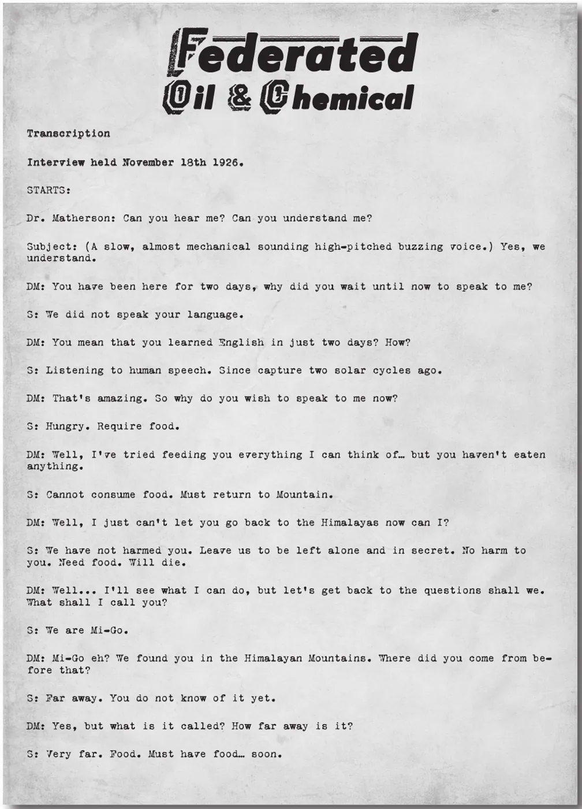

## Раздатка «Жатва» 11

> **Раздатка «Жатва» 11** (лист 1)
>
> *Бланк «Федерейтед Ойл энд Кемикал»*
>
> **Расшифровка**
>
> Допрос проведён 18 ноября 1926 года.
>
> НАЧАЛО:
>
> Д-р Мэтерсон: Вы меня слышите? Вы меня понимаете?
>
> Объект: (Медленный, почти механический высокий жужжащий голос.) Да, мы понимаем.
>
> ДМ: Вы здесь уже два дня. Почему вы до сих пор не заговорили со мной?
>
> О: Мы не говорили на вашем языке.
>
> ДМ: Хотите сказать, вы выучили английский всего за два дня? Как?
>
> О: Слушая человеческую речь. С захвата два солнечных цикла назад.
>
> ДМ: Поразительно. Так почему вы хотите поговорить со мной теперь?
>
> О: Голодны. Нужна пища.
>
> ДМ: Ну, я пыталась кормить вас всем, что пришло в голову… но вы ничего не съели.
>
> О: Не можем потреблять пищу. Должны вернуться на Гору.
>
> ДМ: Ну, не могу же я сейчас отпустить вас обратно в Гималаи, верно?
>
> О: Мы не причинили вам вреда. Оставьте нас в покое и в тайне. Вам нет вреда. Нужна пища. Умрём.
>
> ДМ: Что ж… посмотрю, что можно сделать, но давайте вернёмся к вопросам. Как мне вас называть?
>
> О: Мы — Ми-Го.
>
> ДМ: Ми-Го, вот как? Мы нашли вас в Гималаях. Откуда вы пришли до того?
>
> О: Издалека. Вы ещё не знаете о нём.
>
> ДМ: Да, но как оно называется? Как далеко это?
>
> О: Очень далеко. Пища. Нужна пища… скоро.
