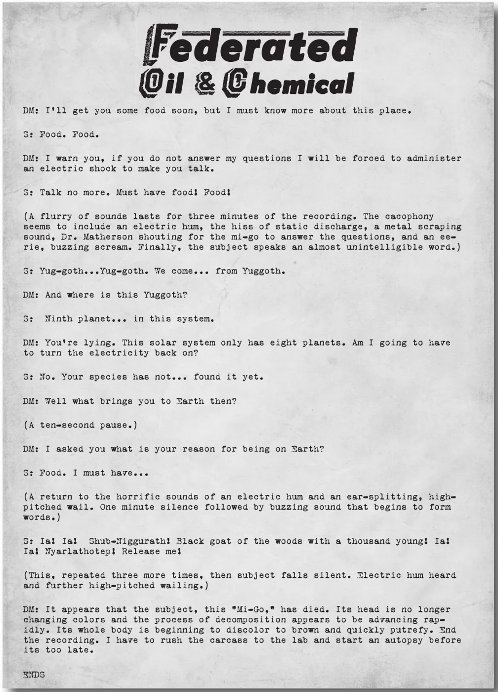

> **Раздатка «Жатва» 11** (лист 2)
>
> *Бланк «Федерейтед Ойл энд Кемикал»*
>
> ДМ: Я скоро достану вам пищу, но я должна узнать больше об этом месте.
>
> О: Пища. Пища.
>
> ДМ: Предупреждаю: если вы не ответите на мои вопросы, мне придётся применить электрический разряд, чтобы вы заговорили.
>
> О: Больше не говорить. Нужна пища! Пища!
>
> (Три минуты записи — шквал звуков. В какофонии, похоже, слышны гудение тока, шипение статического разряда, скрежет металла, крики доктора Мэтерсон, требующей, чтобы ми-го отвечал на вопросы, и жуткий жужжащий вопль. Наконец объект произносит почти неразборчивое слово.)
>
> О: Юг-гот… Юг-гот. Мы пришли… с Юггота.
>
> ДМ: И где этот Юггот?
>
> О: Девятая планета… в этой системе.
>
> ДМ: Вы лжёте. В Солнечной системе только восемь планет. Мне что, снова включить ток?
>
> О: Нет. Ваш вид ещё не… нашёл её.
>
> ДМ: Ну и что же привело вас на Землю?
>
> (Пауза десять секунд.)
>
> ДМ: Я спросила, зачем вы на Земле?
>
> О: Пища. Я должен получить…
>
> (Снова жуткие звуки: гудение тока и пронзительный, раздирающий уши вой. Минута тишины, затем жужжание, которое начинает складываться в слова.)
>
> О: Иа! Иа! Шуб-Ниггурат! Чёрный Козёл Лесов с Тысячей Младых! Иа! Иа! Ньярлатхотеп! Отпустите меня!
>
> (Повторено ещё три раза, затем объект умолкает. Слышны гудение тока и снова пронзительный вой.)
>
> ДМ: Похоже, объект, этот «Ми-Го», умер. Его голова больше не меняет цвет, и разложение, судя по всему, идёт быстро. Всё тело начинает буреть и быстро гниёт. Конец записи. Мне нужно срочно везти тушу в лабораторию и начинать вскрытие, пока не поздно.
>
> КОНЕЦ
