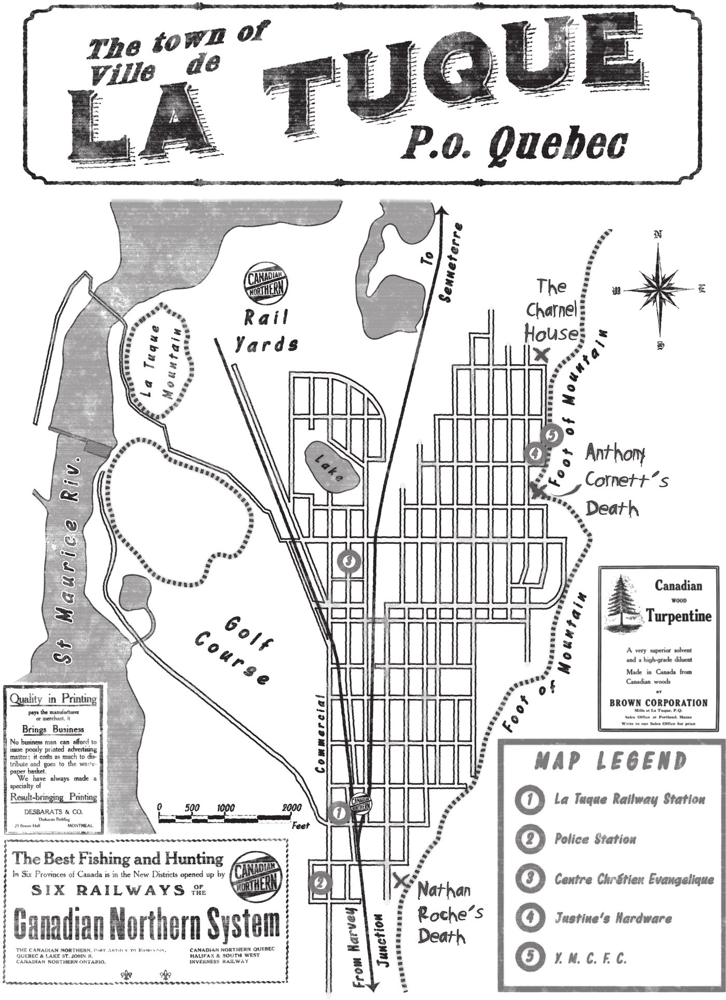

## Карта Ла-Тюка

**Подписи на карте.** Заголовок: «The town of / Ville de La Tuque, P.o. Quebec» («Город Ла-Тюк, провинция Квебек»).

| Подпись на карте | Перевод |
|---|---|
| Map Legend | Условные обозначения |
| 1 — La Tuque Railway Station | 1 — вокзал Ла-Тюка |
| 2 — Police Station | 2 — полицейский участок |
| 3 — Centre Chrétien Evangelique | 3 — Евангелический христианский центр |
| 4 — Justine’s Hardware | 4 — скобяная лавка «Жюстин» |
| 5 — Y. M. C. F. C. | 5 — Y.M.C.F.C. (Христианский центр братства молодых людей) |
| The Charnel House | Дом-костница |
| Anthony Cornett’s Death | Место гибели Энтони Корнетта |
| Nathan Roche’s Death | Место гибели Натана Роша |
| Rail Yards | Сортировочная станция |
| St Maurice Riv. | Река Сен-Морис |
| La Tuque Mountain | Гора Ла-Тюк |
| Lake | Озеро |
| Golf Course | Поле для гольфа |
| Foot of Mountain | Подножие горы |
| Commercial | Улица Коммерсьяль |
| To Senneterre | На Сеннетер (железная дорога) |
| From Harvey Junction | От Харви-Джанкшен (железная дорога) |
| Canadian Northern (значок у вокзала) | Канадская северная железная дорога |
| 0 — 500 — 1000 — 2000 Feet | Масштаб: 0–2000 футов (около 600 м) |

**Старинные рекламы на полях карты:**

- «Quality in Printing» («Качественная печать»): качественная печать окупается для фабриканта и торговца — она приносит дело. Ни один делец не может позволить себе выпускать плохо отпечатанную рекламу: её распространение стоит столько же, а попадает она в мусорную корзину. «Мы всегда специализировались на печати, приносящей результат». Desbarats & Co., Desbarats Building, 23 Beaver Hall, Монреаль.
- «Canadian Wood Turpentine» («Канадский древесный скипидар»): превосходный растворитель и высококачественный разбавитель. Сделан в Канаде из канадской древесины компанией «Браун корпорейшн» (Brown Corporation). Фабрики — в Ла-Тюке, провинция Квебек; торговая контора — в Портленде, штат Мэн; цены — по запросу в торговую контору.
- «The Best Fishing and Hunting» («Лучшая рыбалка и охота»): лучшая рыбалка и охота в шести провинциях Канады — в новых краях, которые открыли шесть железных дорог системы Canadian Northern («Канадская северная»): The Canadian Northern (от Порт-Артура до Эдмонтона), Quebec & Lake St. John R. (Квебек — озеро Сен-Жан), Canadian Northern Ontario, Canadian Northern Quebec, Halifax & South West, Inverness Railway.
