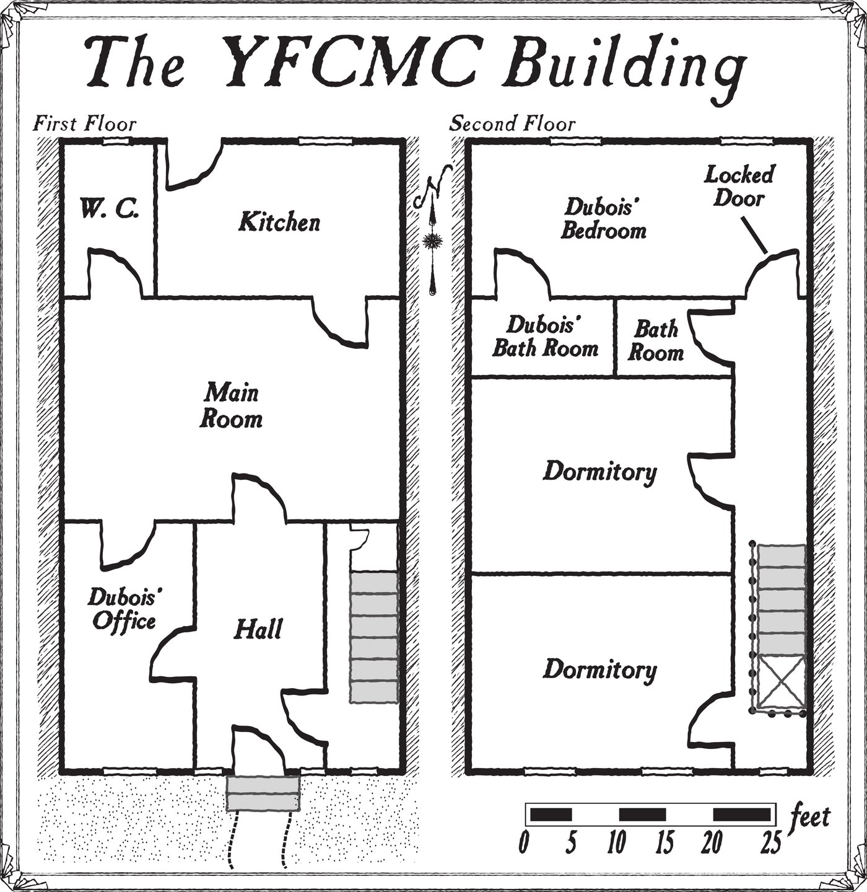

## План Y.M.C.F.C.

**Подписи на плане.** Заголовок: «The YFCMC Building» («Здание YFCMC»).

| Подпись на плане | Перевод |
|---|---|
| First Floor | Первый этаж |
| W. C. | Уборная |
| Kitchen | Кухня |
| Main Room | Общая комната |
| Dubois’ Office | Кабинет Дюбуа |
| Hall | Холл |
| Second Floor | Второй этаж |
| Dubois’ Bedroom | Спальня Дюбуа |
| Locked Door | Запертая дверь |
| Dubois’ Bath Room | Ванная Дюбуа |
| Bath Room | Ванная |
| Dormitory | Общая спальня |
| 0 — 5 — 10 — 15 — 20 — 25 feet | Масштаб: 0–25 футов (около 8 м) |

*Прим. перев.: название приюта в книге расходится: в тексте — Y.M.C.F.C., на плане — «The YFCMC Building», в оглавлении — «YMCMC Map».*
