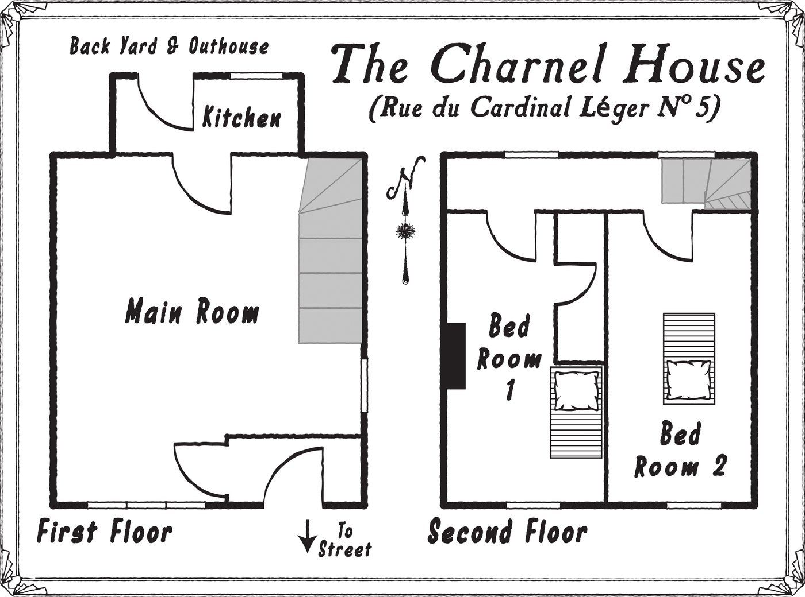

## План дома-костницы

**Подписи на плане.** Заголовок: «The Charnel House (Rue du Cardinal Léger Nº 5)» («Дом-костница, рю дю Кардиналь-Леже, 5»).

| Подпись на плане | Перевод |
|---|---|
| Back Yard & Outhouse | Задний двор и уборная во дворе |
| Kitchen | Кухня |
| Main Room | Общая комната |
| First Floor | Первый этаж |
| To Street | На улицу |
| Second Floor | Второй этаж |
| Bed Room 1 | Спальня 1 |
| Bed Room 2 | Спальня 2 |

Рю дю Кардиналь-Леже лежит на несколько улиц к северу от Y.M.C.F.C., дойти туда — пара минут. Дом номер 5 — небольшое здание в ряду отдельно стоящих домов. Район тихий, и, скорее всего, никто не увидит, как Дюбуа входит с жертвой. Сыщики, наблюдающие за домом и Дюбуа, должны пройти проверку Скрытности, чтобы остаться незамеченными, — но, если только кто-нибудь из них не выкинет чего-нибудь совсем безумного, Дюбуа не обязательно их заметит или заподозрит (его больше заботит следующая жертва).

Миновав запущенный сад, заросший высокой травой и сорняками, Дюбуа отпирает дверь, ведущую в маленькую прихожую, заваленную нераспечатанными картонными коробками. Войдя, он запирает дверь и объясняет, что из-за дел в церкви и приюте всё не было случая распаковаться. И правда: за прихожей — общая комната с голыми оштукатуренными стенами и бетонным полом, заставленная чайными ящиками, набитыми одеждой и прочей домашней утварью. Из комнаты ведут дверь и лестница. Свет даёт электрическая лампа на низком столике у плотно закрытого ставнями окна. В южной стене — большое окно, тоже закрытое ставнями.

Посреди комнаты стоит несобранный буфет, рядом — ящик с инструментами. Дюбуа велит сыщику браться за работу — вскрывать коробки и распаковывать, — а сам идёт к двери на кухню, говоря, что принесёт что-нибудь освежиться.

На самом деле Дюбуа идёт на кухню за хлороформом, спрятанным в шкафу. Вернувшись с бутылкой хлороформа и тряпкой в кармане, он держит в руке стакан лимонада для сыщика. Пока сыщик работает (или делает вид), Дюбуа подходит к нему сзади с тряпкой, смоченной хлороформом.

Успешная проверка Слуха предупреждает сыщика, что Дюбуа прямо у него за спиной, и внезапной атаки не будет. Точно так же сыщику, заявившему, что он подозревает Дюбуа, можно разрешить проверку Психологии, чтобы понять, что священник вот-вот нападёт.

Если проверка Слуха или Психологии провалена, Дюбуа получает внезапную атаку: он пытается провести боевой приём, чтобы зажать сыщику рот и нос пропитанной хлороформом тряпкой. Если сыщик не застигнут врасплох, порядок в бою определяйте по ЛВК. Если приём удался, сыщик должен пройти трудную проверку ВЫН: при провале он теряет сознание. Если с хлороформом дело не ладится, Дюбуа выхватывает нож и приказывает сыщику идти наверх. Если сыщик не подчинится, может завязаться бой. Здесь много чем можно защищаться — например, молотком, ломом или частями буфета, которыми можно орудовать как дубинкой.

Если сыщик заявляет, что кричит или сильно шумит, у сыщиков снаружи
