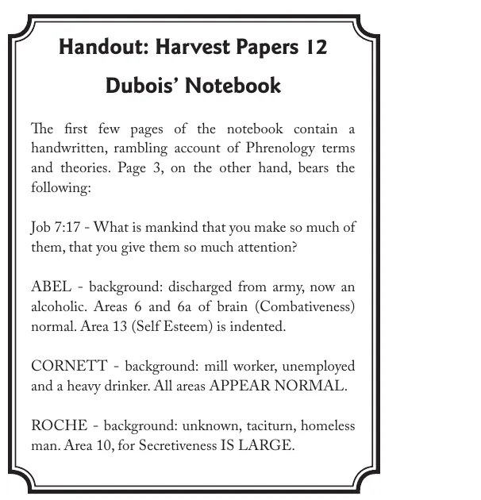

### Задний двор

Густой лес Ла-Тюка подступает к низкому забору вокруг двора, и на первый взгляд этот клочок незасеянной земли ничем не примечателен. Успешная проверка Внимания обнаруживает три недавно вырытые ямы, где Дюбуа закопал останки своих жертв (верхушки черепов и скальпы). Если их выкопать, потребуйте у тех, кто не имеет медицинской подготовки, проверку Рассудка (потеря 0/1d3).



> **Раздатка «Жатва» 12**
>
> **Записная книжка Дюбуа**
>
> Первые несколько страниц записной книжки — сбивчивое рукописное изложение терминов и теорий френологии. Зато на странице 3 написано:
>
> *Иов 7:17 — Что такое человек, что Ты столько ценишь его и обращаешь на него внимание Твоё?*
>
> АБЕЛЬ — прошлое: уволен из армии, теперь алкоголик. Области 6 и 6а мозга (Воинственность) нормальны. Область 13 (Самоуважение) вдавлена.
>
> КОРНЕТТ — прошлое: рабочий фабрики, безработный, сильно пьёт. Все области ВЫГЛЯДЯТ НОРМАЛЬНО.
>
> РОШ — прошлое: неизвестно, молчаливый бездомный. Область 10, Скрытность, — БОЛЬШАЯ.

## Итоги

Полиция Ла-Тюка будет очень довольна, если сыщики помогут раскрыть преступления отца Дюбуа, как и горожане. И детектив Дегармо, и его начальство благодарят сыщиков и крепко жмут им руки — но не более того.

Тибо тоже поздравляет сыщиков и спрашивает, помогли ли эти события их изысканиям для мистера Абеларда. Он же при первой возможности устроит их возвращение в Детройт.

По их возвращении Абелард хочет знать всё, что произошло, — он ждёт новостей о ми-го. Тревожно, что, когда сыщики подтверждают, что смерти — дело рук не ми-го, а безумного священника, он, кажется, начинает скучать и раздражаться. Дав сыщикам закончить рассказ, Абелард предлагает им пойти отдохнуть: сегодня вечером он хочет провести последнее совещание и обсудить планы вермонтского задания. Теперь Хранителю пора вернуться к кульминации эпизода 3 (см. «Неожиданные последствия», с. 16).

## Награды

- Сыщики, положившие конец жутким опытам Дюбуа, получают +1d6 Рассудка.
- Спасение схваченного сыщика или жертвы: +1d6 Рассудка.
- Узнать безумную причину, по которой Дюбуа убивал людей, и тем самым доказать, что ми-го ни при чём: +1d4 Рассудка.
- Если товарищ сыщиков погиб от рук Дюбуа: −1d6 Рассудка.

## Интерлюдия: персонажи

### Николя Тибо, 33 года, юрист

```stat
СИЛ 50    ВЫН 75    ТЕЛ 45    ЛВК 45    ИНТ 75
НАР 80    МОЩ 45    ОБР 90    Рассудок 45    ПЗ 12
БкУ: 0    Комплекция: 0    Скорость: 8    ПМ: 9

Ближний бой (драка)    30% (15/6), урон 1d3
Уклонение              22% (11/4)

Навыки: Бухгалтерское дело 50%, Искусство/ремесло (резьба по дереву) 40%, Обаяние 70%, Средства 65%, Вождение автомобиля 35%, Красноречие 65%, Юриспруденция 85%, Работа в библиотеке 85%, Слух 60%, Естествознание 35%, Убеждение 80%, Психология 70%, Скрытность 65%, Метание 30%.
Языки: французский 90%, английский 65%, латынь 10%.
```

### Отец Максим Дюбуа, 51 год, серийный убийца

```stat
СИЛ 70    ВЫН 80    ТЕЛ 85    ЛВК 50    ИНТ 80
НАР 40    МОЩ 40    ОБР 80    Рассудок 00    ПЗ 16
БкУ: +1d4    Комплекция: 1    Скорость: 5    ПМ: 8

Ближний бой (драка)                        80% (40/16), урон 1d3 + 1d4,
                                           нож 1d4 + 2 + 1d4
Дробовик 20-го калибра (1 ствол)           30% (15/6), урон 2d6
Уклонение                                  30% (15/6)

Навыки: Бухгалтерское дело 40%, Обаяние 30%, Средства 30%, Красноречие 75%, Первая помощь 50%, История 60%, Работа в библиотеке 35%, Слух 60%, Тайные знания (френология) 70%, Оккультизм 20%, Убеждение 55%, Психология 55%, Скрытность 65%, Метание 45%.
Языки: французский 80%, английский 50%, латынь 40%.
```

*Прим. перев.: Скорость 5 — как в оригинале; по правилам (базовая 7, минус 1 за возраст 51) выходит 6. В статблоке у Дюбуа одноствольный дробовик 20-го калибра (урон 2d6), а в описании дома-костницы (с. 30) — одноствольный дробовик 12-го калибра; атака дана как в статблоке.*
