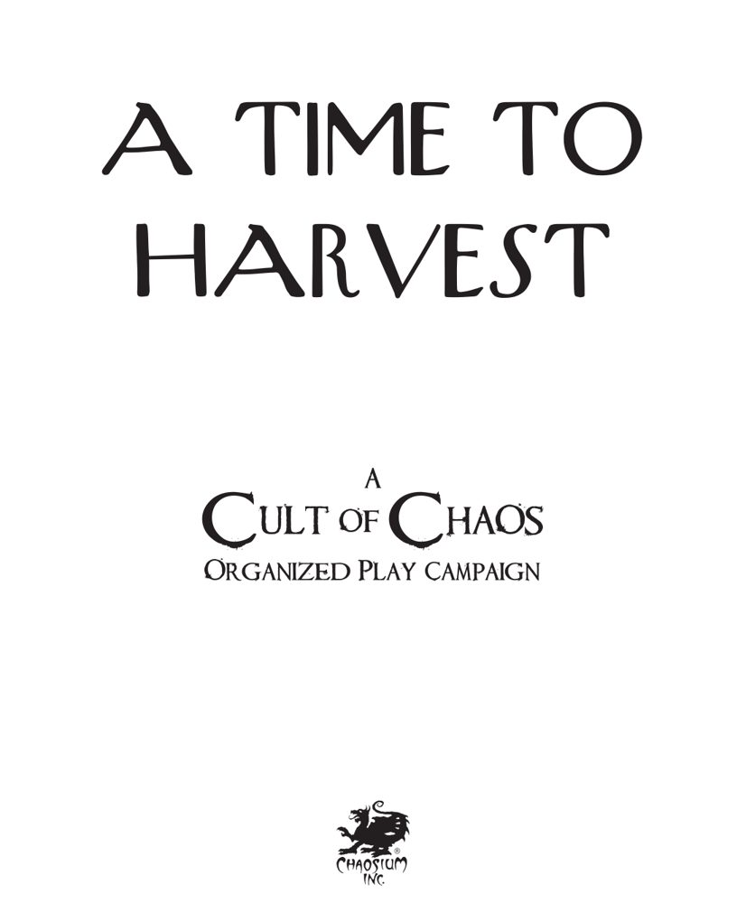

ВРЕМЯ ЖАТВЫ

Кампания организованной игры «Культ хаоса»

Месяц 4

*Обложка шрифтовая: название кампании «A Time to Harvest» («Время жатвы»), под ним — «A Cult of Chaos Organized Play Campaign» («Кампания организованной игры „Культ хаоса“»), внизу — дракон-логотип Chaosium.*
