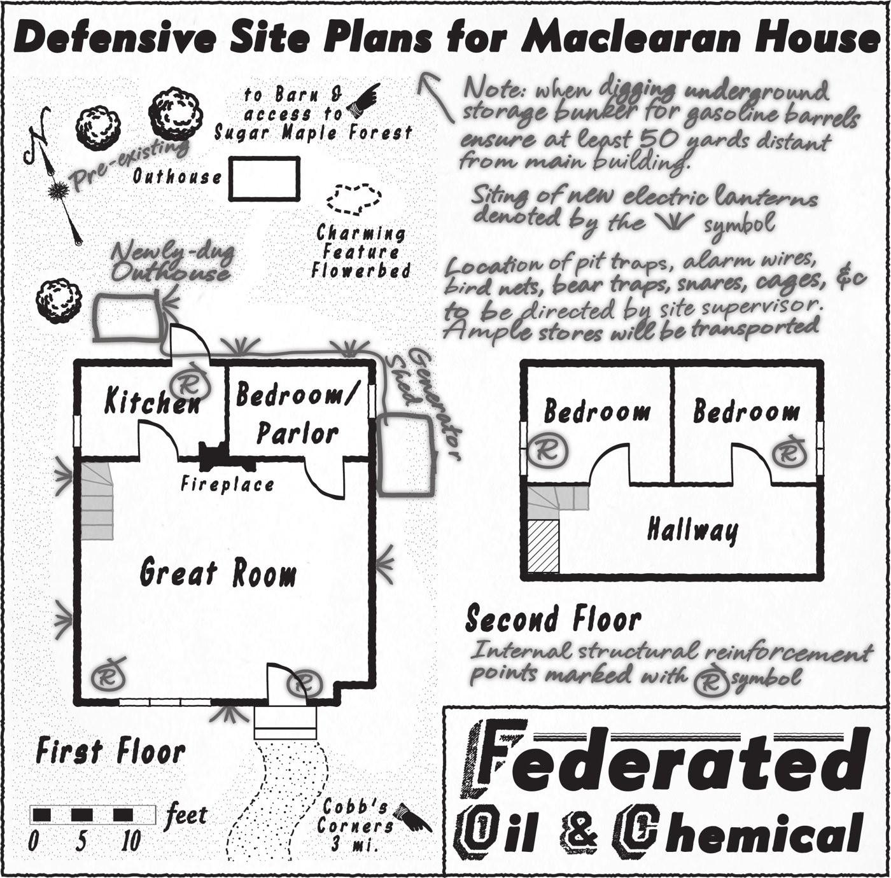

усмотрению Хранителя может заглянуть шериф — посмотреть, что тут творится, и напомнить сыщикам, что он так же легко может снова выставить их из города, если они вернулись только затем, чтобы опять наделать неприятностей. Что бы сыщики ни делали, день должен пройти гладко, без крупных открытий. Это затишье перед бурей.

> **Раздатка: план обороны дома Маклиранов**
>
> **План обороны дома Маклиранов**
>
> *Пометка:* при рытье подземного бункера для бочек с бензином обеспечить расстояние не меньше 50 метров от главного здания.
>
> Места новых электрических фонарей обозначены знаком [фонарь].
>
> Расположение ям-ловушек, сигнальных проволок, сетей на птиц, медвежьих капканов, силков, клеток и пр. — по указанию начальника участка. Припасы будут доставлены в достатке.
>
> *Подписи на плане:* к амбару и выход в лес сахарных клёнов · старый нужник · милая клумба · новый нужник · сарай для генератора.
>
> *Первый этаж:* кухня · спальня/гостиная · камин · большая комната.
>
> *Второй этаж:* спальня · спальня · коридор. Точки внутреннего усиления конструкции отмечены знаком [R].
>
> Коббс-Корнерс — 5 км · шкала масштаба: 0 — 1,7 — 3,3 м
>
> «Федерейтед Ойл энд Кемикал»

## Вторая ночь

Хранителю стоит подразнить сыщика в дозоре — или того, кому пришлось поздно ночью сходить в нужник, — смутными, неузнаваемыми фигурами, движущимися вдали. Может быть, он слышит лёгкое жужжание, отдающееся эхом с холмов, или видит странные огни в ближнем лесу. Что бы Хранитель ни выбрал, это не должно привести к немедленной стычке
