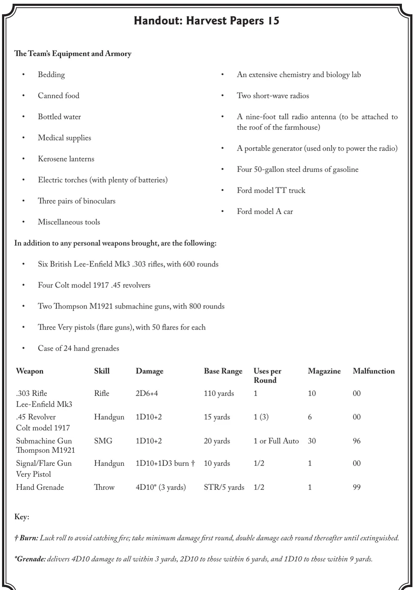

> **Раздатка «Жатва» 15**
>
> **Снаряжение и арсенал команды**
>
> - Постельные принадлежности
> - Консервы
> - Питьевая вода в бутылках
> - Медикаменты
> - Керосиновые лампы
> - Электрические фонари (с большим запасом батареек)
> - Три бинокля
> - Разные инструменты
> - Большая химическая и биологическая лаборатория
> - Две коротковолновые рации
> - Радиоантенна высотой 3 м (крепится на крышу фермерского дома)
> - Переносной генератор (только для питания рации)
> - Четыре 190-литровые стальные бочки бензина
> - Грузовик «Форд» модели TT
> - Легковой автомобиль «Форд» модели A
>
> Помимо личного оружия, которое каждый возьмёт с собой:
>
> - Шесть британских винтовок «Ли-Энфилд» Mk3 калибра .303 и 600 патронов
> - Четыре револьвера «Кольт» модели 1917 калибра .45
> - Два пистолета-пулемёта «Томпсон» M1921 и 800 патронов
> - Три сигнальных пистолета Вери (ракетницы), к каждому 50 ракет
> - Ящик из 24 ручных гранат
>
> | Оружие | Навык | Урон | Базовая дальность | Атак за раунд | Магазин | Осечка |
> |---|---|---|---|---|---|---|
> | Винтовка .303 «Ли-Энфилд» Mk3 | Винтовка | 2d6+4 | 110 метров | 1 | 10 | 00 |
> | Револьвер .45 «Кольт» модели 1917 | Пистолет | 1d10+2 | 15 метров | 1 (3) | 6 | 00 |
> | Пистолет-пулемёт «Томпсон» M1921 | Пистолет-пулемёт | 1d10+2 | 20 метров | 1 или очередь | 30 | 96 |
> | Сигнальный пистолет (ракетница) Вери | Пистолет | 1d10+1d3 горение † | 10 метров | 1/2 | 1 | 00 |
> | Ручная граната | Метание | 4d10* (3 метра) | СИЛ/5 метров | 1/2 | 1 | 99 |
>
> *Пояснения:*
>
> † Горение: проверка Удачи, чтобы не загореться; в первый раунд — минимальный урон, затем каждый раунд урон удваивается, пока огонь не потушат.
>
> \*Граната: 4d10 урона всем в пределах 3 метров, 2d10 — в пределах 6 метров и 1d10 — в пределах 9 метров.
