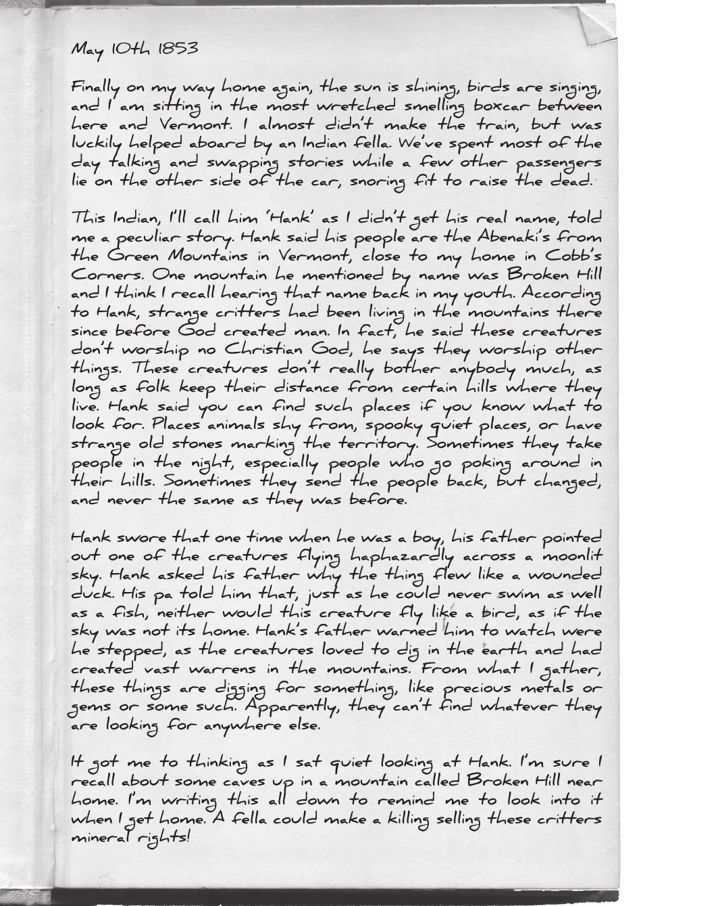

> **Раздатка «Жатва» 16**
>
> *10 мая 1853 года*
>
> Наконец-то снова еду домой: солнце светит, птицы поют, а я сижу в самом вонючем товарном вагоне отсюда до Вермонта. Чуть не опоздал на поезд, но, по счастью, мне помог забраться один индеец. Почти весь день мы болтали и травили байки, а несколько других пассажиров лежат на другом конце вагона и храпят так, что мёртвого разбудят.
>
> Этот индеец — назову его «Хэнк», настоящего имени я так и не узнал — рассказал мне занятную историю. Хэнк сказал, что его народ — абенаки из Зелёных гор в Вермонте, недалеко от моего дома в Коббс-Корнерсе. Одну гору он назвал по имени — Брокен-Хилл, и, кажется, я слыхал это название ещё в юности. По словам Хэнка, в тамошних горах живут странные твари — с тех пор, как Господь ещё и человека не сотворил. Он даже сказал, что эти твари не молятся никакому христианскому Богу, а поклоняются чему-то другому. Никого они особо не трогают, если люди держатся подальше от некоторых холмов, где они живут. Хэнк сказал, что такие места можно найти, если знаешь, что искать: места, которых сторонятся звери, жутко тихие места, или где территорию отмечают странные старые камни. Иногда они забирают людей по ночам, особенно тех, кто суётся в их холмы. Иногда отпускают людей обратно, но изменившимися, и прежними те уже не бывают.
>
> Хэнк божился, что однажды, когда он был мальчишкой, отец показал ему одну такую тварь, которая беспорядочно летела по залитому луной небу. Хэнк спросил отца, почему эта штука летит, как подстреленная утка. Отец ответил: как он сам никогда не будет плавать так же хорошо, как рыба, так и эта тварь никогда не будет летать как птица, — будто небо ей не родной дом. Отец Хэнка велел ему смотреть под ноги: твари любят рыться в земле и прорыли в горах огромные норы. Насколько я понял, эти твари что-то ищут — драгоценные металлы, или самоцветы, или вроде того. Видно, то, что они ищут, больше нигде не найти.
>
> Я сидел молча, смотрел на Хэнка и задумался. Точно помню, что недалеко от дома, на горе под названием Брокен-Хилл, есть какие-то пещеры. Записываю всё это, чтобы не забыть разузнать, когда вернусь домой. Можно озолотиться, продав этим тварям права на недра!
