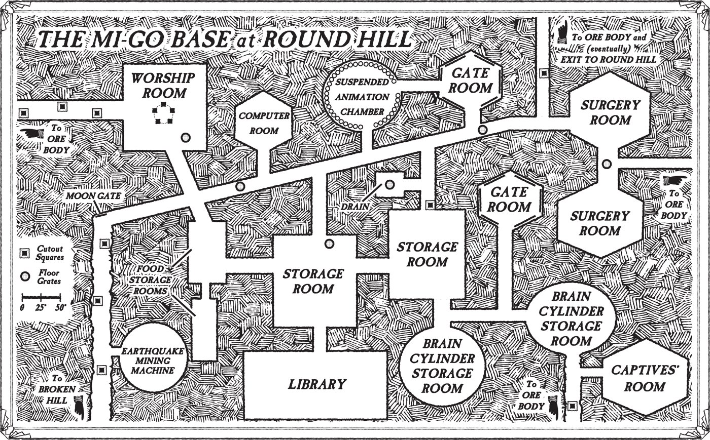

### План базы ми-го под Раунд-Хиллом

*Подписи на плане (в оригинале — по-английски):*

| На плане | Перевод |
|---|---|
| The Mi-Go Base at Round Hill | База ми-го под Раунд-Хиллом |
| Worship Room | Молельный зал |
| Computer Room | Зал компьютера |
| Suspended Animation Chamber | Камера анабиоза |
| Gate Room (2) | Зал врат |
| Surgery Room (2) | Операционная |
| Drain | Сток |
| Storage Room (2) | Склад |
| Food Storage Rooms | Пищевые кладовые |
| Earthquake Mining Machine | Сейсмический бур |
| Library | Библиотека |
| Brain Cylinder Storage Room (2) | Хранилище мозговых цилиндров |
| Captives’ Room | Зал пленников |
| Moon Gate | Лунные врата |
| To Ore Body (3) | К рудному телу |
| To Ore Body and (eventually) Exit to Round Hill | К рудному телу и (в конце концов) выход к Раунд-Хиллу |
| To Broken Hill | К Брокен-Хиллу |
| Cutout Squares | Условный знак: вырезанные квадраты (провалы в полу коридоров) |
| Floor Grates | Условный знак: решётки в полу |
