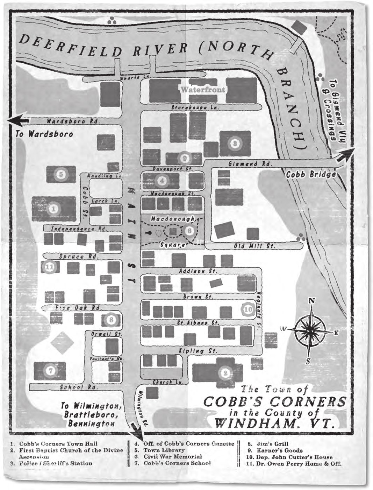

## Карта Коббс-Корнерс для Хранителя

*Подпись на карте: «Городок Коббс-Корнерс в округе Уиндем, Вермонт». Река Дирфилд (северный рукав), пристани, мост Кобба; дороги на Уордсборо, к долине Гисменд и переправам, на Уилмингтон, Браттлборо и Беннингтон.*

**Ключ карты**

1. Ратуша Коббс-Корнерс
2. Первая баптистская церковь Божественного Вознесения
3. Полиция / контора шерифа
4. Редакция «Газетт Коббс-Корнерс»
5. Городская библиотека
6. Памятник Гражданской войны
7. Школа Коббс-Корнерс
8. Закусочная Джима
9. Лавка «Товары Карнеров»
10. Дом помощника шерифа Джона Каттера
11. Дом и приёмная доктора Оуэна Перри
