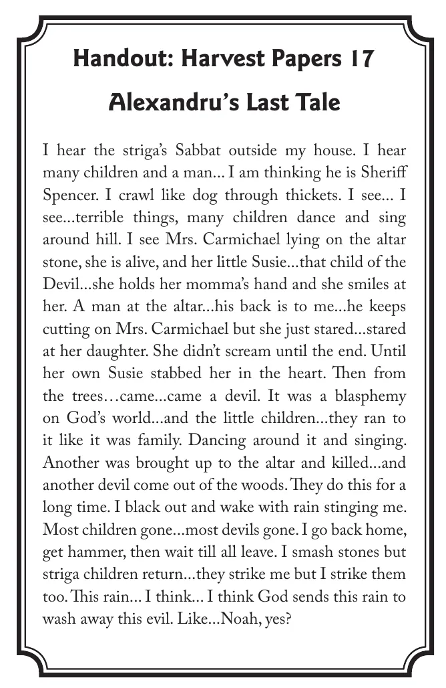

```stat
СИЛ 360   ВЫН 850   ТЕЛ 600   ЛВК 140   ИНТ 105
НАР —     МОЩ 350   ОБР —     Рассудок —   ПЗ 145
БкУ: +11d6   Комплекция: 12   Скорость: 15   ПМ: 70

Атак за раунд: 1 (удар щупальцами, хватка/укус, растаптывание).
У Шуб-Ниггурат множество щупалец, которые мечутся вокруг и могут поразить противников.

Хватка (манёвр): у Шуб-Ниггурат десятки щупалец, но за раунд она может схватить лишь одну жертву. При удачном захвате жертву хватают и подтягивают к телу богини, где одна из её многочисленных пастей высасывает из неё жидкости тела: укус навсегда отнимает у жертвы 3d10 СИЛ за раунд. Пока из жертвы высасывают соки, она совершенно беспомощна: не может творить заклинания, тратить очки магии или делать что-либо ещё, кроме как корчиться от боли и кричать.

Растаптывание: раз в раунд Шуб-Ниггурат может растаптывать существ с ТЕЛ 300 или меньше. Растаптывание действует на всех таких существ на её пути, а это в среднем полоса шириной 10–20 метров.

Ближний бой            75% (37/15), урон 5d6
Хватка (манёвр)        хватает одну жертву, в следующем раунде — автоматический укус
Укус                   автоматически, если жертва схвачена; урон — 3d10 СИЛ за раунд (высасывание)
Растаптывание          75% (37/15), 11d6

Броня: брони нет, но её слизистое туманное тело невосприимчиво к физическому оружию. Магическое оружие, огонь, электричество и подобные виды энергии ранят её как обычно. Её канатоподобные щупальца и клейкие пары могут сливаться вновь, по сути позволяя ей восстанавливать очки урона: каждое потраченное очко магии исцеляет 2 очка урона.
Заклинания: Шуб-Ниггурат знает по меньшей мере все заклинания, связанные с богами Мифов; известно, что она передавала своим любимцам «Создание врат», «Зловещее проклятье Азатота» и «Вурский знак».
Потеря Рассудка: 1d10/1d100 очков Рассудка, если увидеть Шуб-Ниггурат.
```

# Раздатки для игроков

## Раздатка «Жатва» 17



*Перевод — с. 8.*
