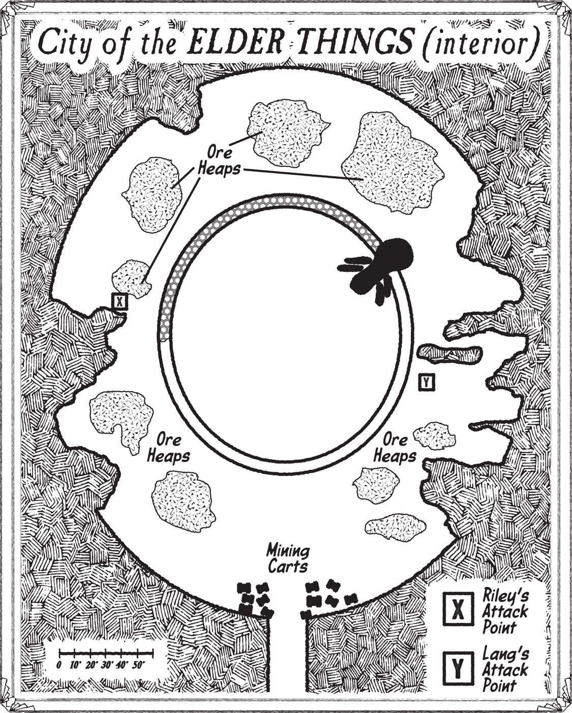

## Город Старцев (внутри)

*Подписи на карте: «Город Старцев (внутри)»; «Груды руды» (три места) — груды паскуаллия; «Рудничные вагонетки» — у устья туннеля; в центре — круглая канава, по которой ходит машина-паук (чёрный силуэт на её северном краю); масштабная линейка — в футах.*

**Ключ карты**

- **X** — точка атаки Райли.
- **Y** — точка атаки Лэнга.
