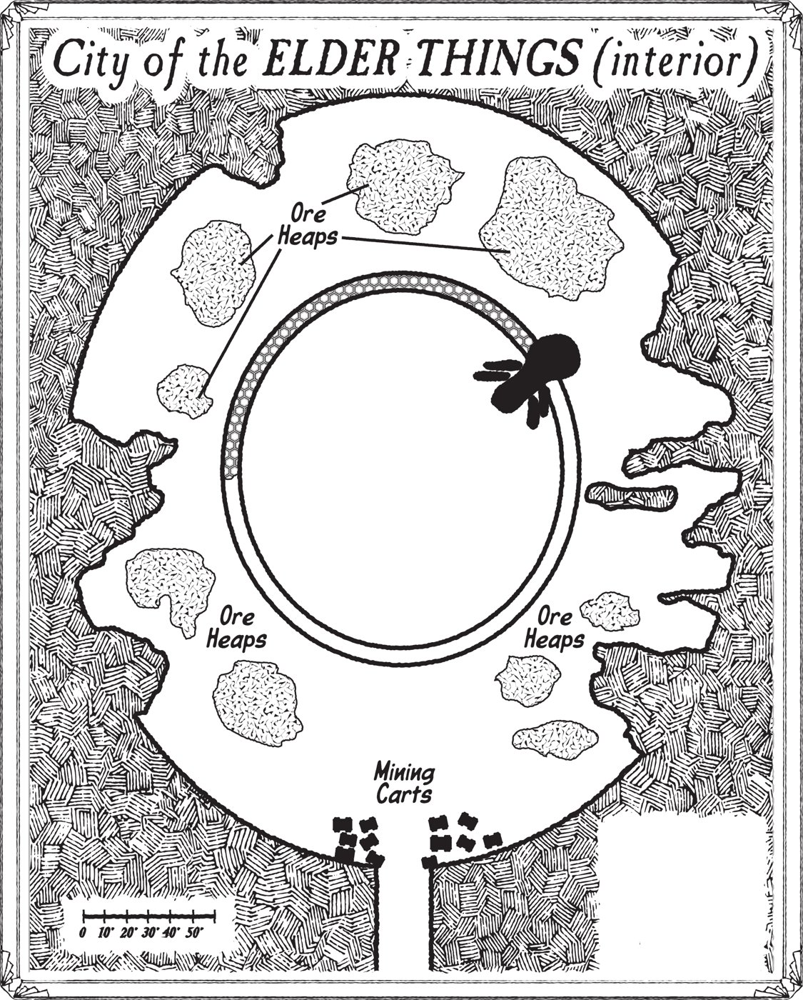

# Раздатки для игроков

## Город Старцев (внутри) — карта для игроков

*Подписи на карте: «Город Старцев (внутри)»; «Груды руды» (три места) — груды паскуаллия; «Рудничные вагонетки» — у устья туннеля; в центре — круглая канава, по которой ходит машина-паук (чёрный силуэт на её северном краю); масштабная линейка — в футах. В отличие от карты Хранителя (с. 13), точек атаки X и Y на ней нет.*
