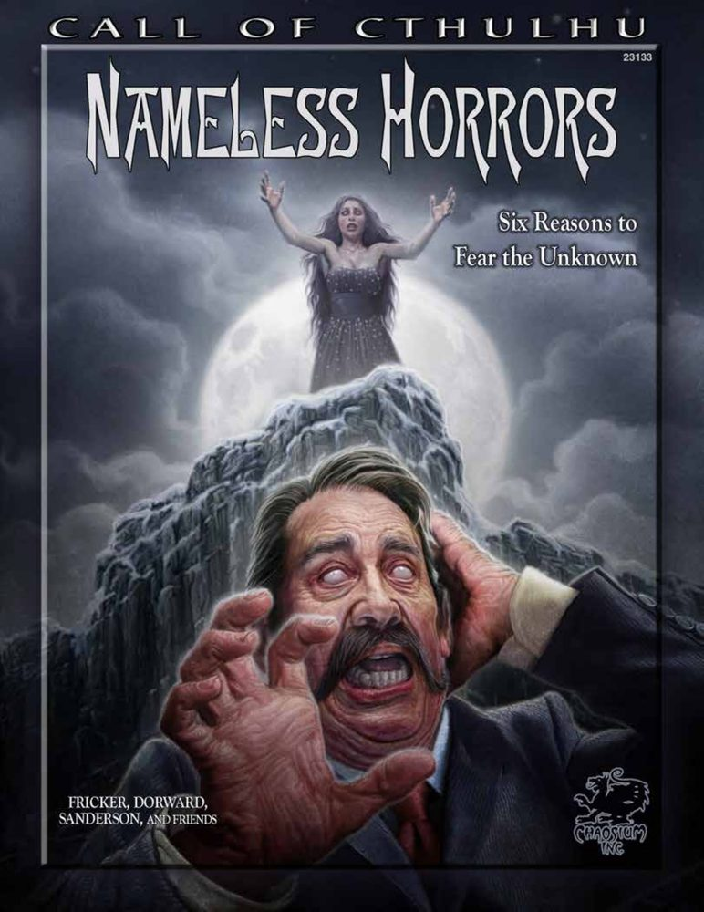

Зов Ктулху

БЕЗЫМЯННЫЕ УЖАСЫ

Шесть причин бояться неизвестного

Фрикер, Дорвард, Сандерсон и друзья

*На обложке (худ. Виктор Леса) — женщина в длинном платье воздевает руки на вершине заснеженной скалы на фоне полной луны; внизу — мужчина с бакенбардами и пышными усами, с белыми незрячими глазами, в ужасе схватился за голову. Вверху — «Call of Cthulhu», название «Nameless Horrors» и подзаголовок «Six Reasons to Fear the Unknown», номер издания 23133; внизу — «Fricker, Dorward, Sanderson and friends» и логотип Chaosium Inc.*
