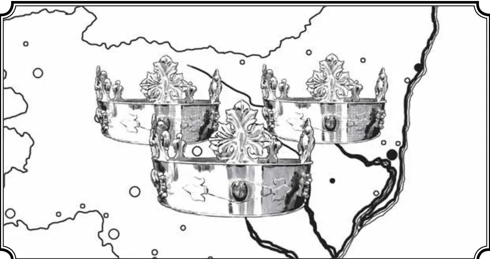

## Предыстория

### Три короны

Королевство Восточная Англия издавна изображают в виде трёх корон на щите. Легенда гласит, что эти три короны — короны древних саксонских королей этих земель («Вуффингов»), зарытые, чтобы защищать край от угроз из-за моря. Пока хотя бы одна из корон остаётся на своём месте, Восточная Англия будет в безопасности — так говорит легенда.

Считалось, что короны зарыты вдоль берега и образуют защитную преграду, которую не пересечь ни одному захватчику. Одну из корон — корону Редвальда, короля восточных англов, — откопали в Рендлшеме в 1687 году и переплавили ради серебра. Хоть это место и не на самом берегу, оно лишь в нескольких километрах от побережья, на одном из главных путей с моря.

Две другие короны пока не найдены. Однако ходят слухи, что одна из них хранилась в древнем саксонском дворце, который поглотило море. Разрушение берега — тяжёлая беда всего побережья Восточной Англии, и никто не знает этого лучше Данвича. Именно здесь, по слухам, зарыта одна из двух ненайденных корон. Другая и поныне скрыта где-то на диких просторах побережья Восточной Англии.

### Повесть о Саре Браун

В XIII веке Данвич был одним из крупнейших портов восточной Англии — почти 1,6 км в поперечнике. Славу ему принесли его корабли и корабелы. Порт и рынок кипели жизнью: здесь торговали с купцами со всей Европы и Скандинавии — от Исландии до Балтики, от Нидерландов до Франции.

Сара Браун родилась в Данвиче в 1258 году. Её мать, Агнес, умерла при родах. Отец, Томас Браун, был местным рыбаком. Скромного дохода Томаса хватало, чтобы у него и дочери была еда на столе. Он происходил из богатой семьи, но родные отреклись от него, когда он полюбил простолюдинку Агнес. Томас умел читать и писать и передал эти умения Саре в надежде, что они помогут ей добиться большего. Когда Саре было тринадцать, море в бурю забрало её отца, и она осталась одна на свете. После этой беды она работала в поле, но едва зарабатывала себе на пропитание. Других умений у неё не было, и выбор был невелик.

Сару растили богобоязненной, но смерть Агнес пошатнула веру Томаса. После смерти Томаса быстро истаяла и вера самой Сары. Бог прежде времени забрал у неё обоих родителей и оставил её одну с жизнью, обречённой быть тяжкой и несчастной. То немногое, что осталось от её веры, обратилось в обиду, а затем — в гнев и ненависть.

Ища любой способ нанести удар Богу, она обратилась к рассказам о ведьмах, что водились на побережье. Она искала их и в конце концов нашла троих колдунов — двух женщин и мужчину, — которые поклонялись Древним богам, что были прежде человечества. Присмотревшись к её нраву и побуждениям, трое приняли Сару в свой круг и открыли ей пути магии.

Сара посвятила себя Древним богам и вскоре постигла истину. Христианского Бога не было. Вера, которую проповедовала церковь, была ложью, сотканной, чтобы скрыть от человечества ужас того, насколько ничтожно оно во вселенной.
