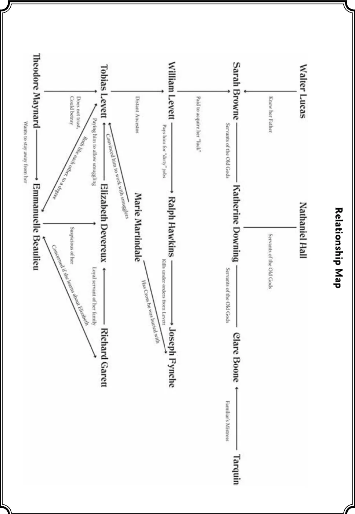

## Карта связей

*Подписи карты связей (стрелка — от кого к кому):*

| От кого | К кому | Связь |
|---|---|---|
| Уолтер Лукас | Сара Браун | знал её отца |
| Натаниэль Холл | Кэтрин Даунинг | Слуги Древних богов |
| Сара Браун | Кэтрин Даунинг | Слуги Древних богов |
| Кэтрин Даунинг | Клэр Бун | Слуги Древних богов |
| Тарквин | Клэр Бун | хозяйка фамильяра |
| Уильям Левет | Сара Браун | платил, чтобы заполучить её «удачу» |
| Уильям Левет | Ральф Хокинс | платит ему за «грязную» работу |
| Ральф Хокинс | Джозеф Финч | убивает по приказу Левета |
| Тобайас Левет | Уильям Левет | далёкий предок |
| Мари Мартиндейл | Тобайас Левет | убедила его работать с контрабандистами |
| Мари Мартиндейл | Джозеф Финч | у неё крест, с которым его похоронили |
| Элизабет Деверо | Тобайас Левет | платит ему, чтобы он не мешал контрабанде |
| Ричард Гаррет | Элизабет Деверо | верный слуга её семьи |
| Теодор Мейнард | Тобайас Левет | не доверяет, может предать |
| Теодор Мейнард | Эммануэль Больё | хочет держаться от неё подальше |
| Тобайас Левет ↔ Эммануэль Больё | | оба до некоторой степени симпатизируют друг другу |
| Эммануэль Больё | Элизабет Деверо | подозревает её |
| Ричард Гаррет ↔ Эммануэль Больё | | встревожен, если она узнает об Элизабет |
