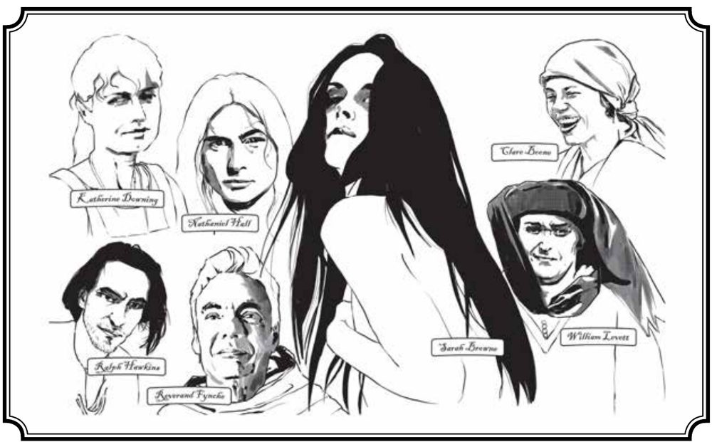

*Действующие лица. Подписи на рисунке: Кэтрин Даунинг, Натаниэль Холл, Ральф Хокинс, преподобный Финч, Сара Браун, Клэр Бун, Уильям Левет.*

**Зацепки для отыгрыша:**

- Боязливо не доверяет чужакам (ведь многие захотят убить ведьму).
- Она знает истинную природу мира. То, что ей ведома такая ужасная правда, видно по её глазам. Она редко моргает и часто пристально смотрит на собеседника.

#### Клэр Бун

**Описание:** короткие светлые волосы, тёплая улыбка. На её вытянутой руке часто сидит Тарквин.

**Черты:** дружелюбная и обходительная.

**Зацепки для отыгрыша:**

- Она упивается тем, что знает истину, которую открыли немногие. В общении с чужаками у неё есть что-то лукавое, почти дразнящее.
- Она знает, что благословлена силой Древних богов, и это даёт ей исключительную уверенность в себе — но без высокомерия.

#### Натаниэль Холл

**Описание:** взлохмаченные волосы, резкие черты лица, одна бровь приподнята.

**Черты:** тихий и внимательный.

**Зацепки для отыгрыша:**

- Потрясённый откровениями Древних богов, он живёт в страхе перед их гневом, если подведёт их.
- Он знает своё место в ковене — на самой нижней ступеньке. Он ведёт себя с остальными подобострастно.

### Тарквин

Фамильяр Клэр Бун, помогающий Слугам Древних богов искать Сару. Снаружи существо похоже на сипуху, но на деле это создание, посланное Древними богами Клэр в благодарность за её служение. Если на неё надавить, Клэр назовёт Тарквина «даром от Той, что ходит нехожеными тропами». Существо умеет менять облик. Под слоем перьев, в обличье совы, у него чёрная кожистая шкура, выдающая его неестественную природу.

Существо подчиняется только приказам Клэр, которые она отдаёт на гортанном, нечеловеческом языке, и мгновенно бросается на любого, кто угрожает Слугам. «Истинного облика» как такового у него нет, но в каждом облике, который оно принимает, есть скрытое искажение (вроде упомянутой кожистой шкуры), выдающее обман. Кроме того, оно не может стать больше крупной собаки или меньше кошки. Облик оно меняет меньше чем за секунду, с пугающей лёгкостью выворачивая своё тело.

### Уильям Левет

Уильям Левет — предок Тобайаса Левета (одного из готовых сыщиков, таможенного чиновника). Кроме того, Уильям Левет насквозь продажен и жаждет власти. Он стремится заполучить корону из-под церкви Святого Варфоломея,
