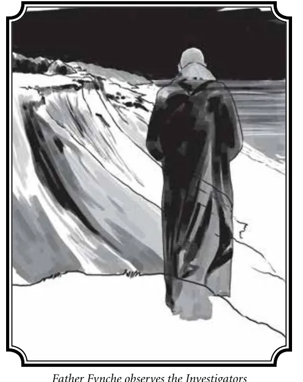

*Отец Финч наблюдает за сыщиками.*

Те, кто провалил проверку **Пилотирования** или **Плавания**, оказываются под волнами. В холоде и темноте, пытаясь выбраться на поверхность, они слышат зловещий звон церковного колокола где-то вдали, под волнами; дрожь от него проходит сквозь их тела.

Внезапно все шлюпки, которыми ещё правят сыщики, со скрежетом останавливаются, будто сели на мель. Вылетев из шлюпки, сыщики проносятся по воздуху и падают на холодную грязную землю. Сыщики, бьющиеся под волнами, отчаянно гребут и карабкаются вверх — и вдруг падают на землю, хватая ртом воздух. Воздух ледяной. В небе висит полная луна, вокруг — тёмный лес. Это требует проверки **Рассудка** (0/1d2).

## Данвич: 1287

Этот раздел — сердцевина сценария. Сыщики, несомненно, увидят описанные здесь события с самых разных точек зрения и в разном порядке, повторяя этот вечер снова и снова. Каждый раз им следует чуть лучше понимать, что происходит.

### Хронология событий

Чтобы облегчить жизнь Хранителю, точное время событий не указано — только порядок, в котором они происходят друг относительно друга. Так история может течь естественно, не скованная мелочами.

1. Каждый виток сыщики начинают в лесу к югу от Данвича. Несколько мгновений спустя над их головами с востока (с моря) пролетает Тарквин, направляясь на запад (вглубь суши). Это может помочь встрече со Слугами Древних богов.
2. Если ему не помешать, Хокинс убивает Финча. В церкви Святого Варфоломея появляется призрак. Затем Хокинс поджигает мельницу.
3. Пока мельница горит, Левет прибывает с Сарой в церковь Святого Варфоломея и рассказывает, как обнаружил, что она ведьма, и что пришёл очистить её душу огнём. В то же время Хокинс направляется к дому Сары в портовом квартале.
4. Хокинс поджигает дом Сары, и на улицах становится больше городской стражи. Затем он возвращается в дом Левета неподалёку.
5. Слуги Древних богов входят в церковь и, разыскивая Сару, сталкиваются с призраком. Поднявшийся шум привлекает проходящего мимо Уолтера Лукаса, и тот звонит в колокол, зовя на помощь.
6. Сара, слыша звон колокола, когда священники вот-вот сожгут её заживо, возносит молитву Древним богам. Вскоре она умирает, и весь восточный горизонт озаряют молнии. Поднимается ветер, и буря обрушивается на город. Затем петля перезапускается.

Как сказано в разделе **«Советы Хранителю»** (с. 7), темп, с которым заканчиваются витки петли, Хранитель может регулировать. Учитывайте действия сыщиков относительно приведённой хронологии. Когда покажется, что пора начинать новый виток (если сыщики потратили много времени на какую-то линию расследования, не пересекающуюся с главными событиями, или если они далеко отклонились от сюжета, уйдя далеко за город), Хранителю следует начать описывать звон колокола, вспышки молний на востоке неба и стремительно нарастающую бурю. Затем петля перезапускается, и сыщики снова оказываются в тёмном лесу (см. **«Ночь начинается снова»**, с. 18).

### Важные эффекты

Когда сыщики осознают следующие эффекты, это помогает усилить и чувство спешки (они поймут, что их время ограничено), и осторожность (они поймут, что все делят страдания друг друга). Хранителю следует всегда держать их в уме.
