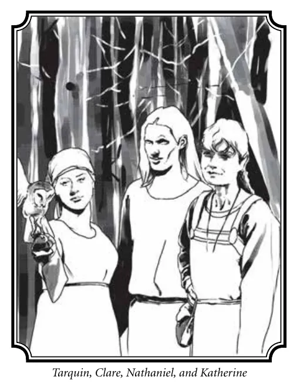

> **Что такое пустота?**
>
> Хранителю может понадобиться более определённое объяснение того, что такое пустота, если он ведёт сценарий для сыщиков с навыком **Мифов Ктулху**, которые ищут ответ на этот вопрос.
>
> Сама пустота — богоподобное существо, которое Сара в своей молитве называет «*Тот, кто есть тьма за ночью*» и «*Тот, кто пребывает вне нашей досягаемости*». Присутствие, которое чувствуют сыщики, — это взгляд этого существа, обращённый на них из-за пределов человеческого понятия о реальности. Это существо — космическое воплощение забвения и отсутствия всего (пространства, времени, материи, света и т. д.). Оно существует в промежутках между; оно стремится, чтобы его впустили, — тогда оно сможет поглотить всё сущее, чтобы осталось одно лишь ничто. И действительно, под его влиянием все сыщики понемногу истачиваются в ничто, а повторение гибели города созвучно его природе. Точно так же по самой своей природе оно неосязаемо и непобедимо. В конце концов, как уничтожить воплощение чистого ничто?

*Тарквин, Клэр, Натаниэль и Кэтрин.*

## В лесу

В лесу холодно и темно — почти как зимним вечером, который сыщики пережили в 1895 году. Однако ветер стих, в воздухе лишь лёгкий ветерок, а шум моря доносится, похоже, не меньше чем с 800 м к востоку. Несколько минут назад сыщики были на берегу моря, а теперь они дальше от него, вглубь суши.

Первые несколько минут сыщики, скорее всего, будут сбиты с толку, пытаясь понять, где они. Они быстро сообразят, что находятся в лесу, где нет никаких ориентиров, кроме редко хоженой тропы сквозь подлесок. Самая заметная перемена на небе — полная луна, тогда как в 1895 году было новолуние. Кроме того, трудная проверка **Знания** или обычная проверка **Науки (астрономия)** позволит понять, что созвездие Ориона сместилось (а вместе с ним и всё ночное небо). В 2 часа ночи 25 января Орион приближался к западному горизонту. Теперь, 1 января, он стоит высоко над юго-западным горизонтом. Это можно истолковать по-разному. Если бы изменилось только положение звёзд, можно было бы утверждать, что сыщики каким-то образом потеряли день и теперь середина следующей ночи. Однако полная луна говорит о куда большем сдвиге во времени.

В подходящий для драмы момент над головами сыщиков бесшумно пролетает Тарквин (фамильяр Клэр Бун). Сыщики чувствуют внезапное движение воздуха над собой, и чёрная фигура на секунду заслоняет луну. Почти призрачная фигура совы затем пикирует вниз и летит вдоль тропы на запад, вглубь леса. Если сыщики последуют за ней, они вскоре увидят, как сова садится на вытянутую руку Клэр Бун. С Клэр — Кэтрин Даунинг и Натаниэль Холл; все трое одеты для жизни под открытым небом (меха и кожи), но огня с собой не несут и идут лишь при свете луны. Они непременно отпустят замечание о странной одежде сыщиков (несколько непохожей на одежду XIII века).

На усмотрение Хранителя можно пройти трудную проверку **Слуха**, чтобы услышать, как Клэр говорит с Тарквином на гортанном, нечеловеческом языке, а сова тут же отвечает ей тем же; при провале сыщик всё же замечает — но не слышит, — что Клэр что-то шепчет. Этот эпизод советуем приберечь для одного из следующих витков, а не для первого.

Кэтрин, Клэр и Натаниэль пришли в лес искать Сару, которая должна была встретиться с ними две ночи назад. Она никогда не опаздывает и всегда держит обещания. Сара созвала их, чтобы обсудить, как проникнуть в церковь, после того как почуяла внутри силу короны, но ей не хватило терпения, и она отправилась разведать место заранее (и так попала в руки Хокинсу).

Когда Сара не пришла, трое под покровом темноты (поздно прошлой ночью) отправились к её дому в городе и нашли его пустым. Этой ночью они вернулись, чтобы посмотреть, не появится ли Сара, но уже начали подозревать, что она попала в беду со священниками. Они обсуждают, не вернуться ли в Данвич и не проникнуть ли в церковь, где, как они полагают, может быть заперта Сара.

Поначалу трое говорят, что ищут
