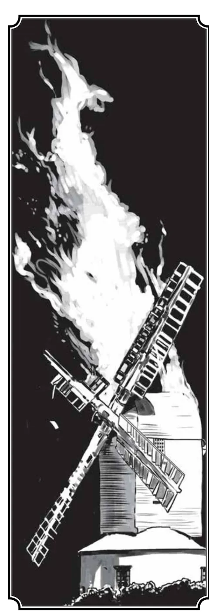

## Мельница

Мельница стоит чуть в стороне от опушки леса, который сыщики назвали бы Лесом Грейфрайерс, к югу от Данвича. Окрестные поля сейчас, зимой, голы. В первом витке к приходу сыщиков мельница уже пылает, но в следующих витках они могут попытаться добраться туда достаточно быстро, чтобы предотвратить убийство и поджог.

Когда сыщики подходят туда в первый раз, местные, увидевшие пожар, уже собираются с вёдрами и выстраиваются цепочкой, передавая воду из ближнего пруда в лесу. Со временем к ним присоединяются человек тридцать. Группа мужчин из города тревожно ждёт у входа, когда изнутри выйдет их товарищ — он пошёл проверить, нет ли там выживших. Незадачливый спасатель, кашляя и отплёвываясь, выбирается наружу с почерневшим от сажи лицом и говорит, что, кажется, видит кого-то наверху, но дым оказался ему не по силам.

Если кто-то из сыщиков пойдёт внутрь, потребуйте проверок **ВЫН** (чтобы выдержать дым) и/или **ЛВК** (чтобы увернуться от горящих обломков), пока они поднимаются по ступеням на верхний этаж. Провал проверки ВЫН наносит 1d2 урона, а провал проверки ЛВК — 1d4 урона от падающих горящих деревяшек. Помните, что этот урон, как и весь урон за ночь, почувствуют и остальные сыщики.

Внутри мельница разделена на три этажа. Нижний этаж почти пуст, ведь сейчас зима, а в другое время здесь хранились бы запасы зерна и муки. Проверка **Внимания** здесь позволяет найти брошенные треснувшие горшки, маслянистое содержимое которых горит.

На среднем этаже стоят жернова, соединённые с вертикальным валом. Здесь можно найти ещё брошенные горшки — масло из них выплеснуто на пустые бочки и груды дерева. Быстро становится ясно, что это не случайность и что пожар устроили намеренно. Однако стены вокруг лестницы пощажены (их не облили маслом и не подожгли), в отличие от остального строения. Может быть, поджигатель позаботился о том, чтобы самому успеть сбежать, — а может быть, хотел, чтобы кто-то поднялся наверх, пока здание горит?

Ещё одна успешная проверка **Внимания** позволяет сквозь прогоревшие в потолке дыры отчасти разглядеть фигуру на верхнем этаже, стоящую у наружной стены.

На верхнем этаже — шестерни, соединяющие вертикальный вал с ветровым валом, который вращают крылья снаружи. Здесь к наружной стене пригвождено тело отца Финча — в глумливом подобии распятия. Его облачение разорвано, а на груди вырезан круг. По внутренней стороне круга идёт ряд странных знаков, похожих на какой-то язык. Середину круга заполняют другие линии, пересекающиеся под странными углами, будто образуя ещё одну, бо́льшую букву того же алфавита. Успешная проверка **Оккультизма** открывает, что знак напоминает
