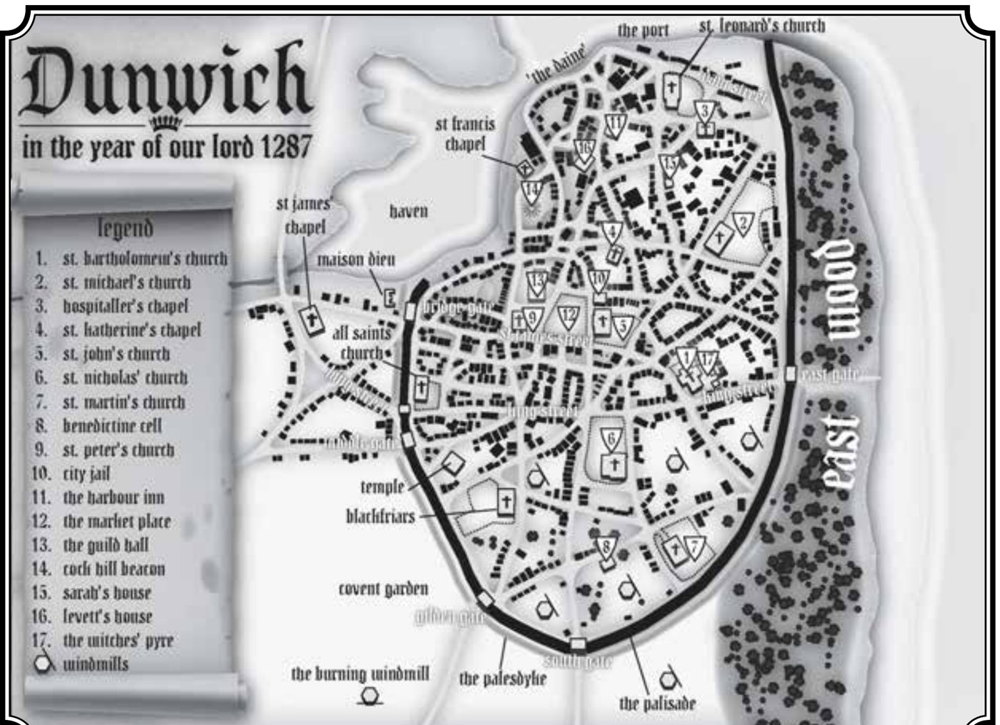

сыщики войдут в ворота. Получив от сыщиков знак щедрости, Лукас может рассказать им всё, что они захотят узнать о городе, как сказано в его описании (с. 14).

Заметив странную одежду сыщиков (ясное дело, они из дальних краёв и приехали сюда по торговым делам, решает он), Лукас может дать совет: если им негде остановиться, в **Портовом трактире** (с. 24) для них, может быть, найдутся комнаты.

## Улицы города

Впервые проходя по улицам Данвича, сыщики смогут лучше прочувствовать, каким был город века назад, прежде чем его бо́льшую часть забрало море. Южные районы города были куда просторнее — с мельницами, деревьями и открытыми лугами площадью до 1,6 гектара, — чем северные, где узкие извилистые улочки окружают порт и рыночную площадь. На юге город в основном ровный, а на севере неровно спускается от церкви Всех Святых и Кок-Хилла к морю. С севера на юг город тянется примерно на 1,6 км, а население его в 1287 году — около 5000 человек. Это делало его одним из крупнейших поселений Восточной Англии в XIII веке, до того как ударила буря.

Видно, что богатство в городе распределено очень неравно. Бедные жители, а их великое множество, влачат жалкое существование рыбной ловлей и обработкой полей и живут на окраинах в ветхих убогих жилищах, мало изменившихся со времён саксов. Богатые жители — в основном купцы и другие дельцы — живут в высоких добротных фахверковых домах у пристани (её называют «Дейн») в северо-восточной части города. Священнослужители, лавочники и ремесленники (кузнецы, гончары и кожевники) тоже живут и работают в домах этого района. Верхние этажи таких домов обычно чуть больше нижних, так что к третьему этажу они нависают над улицей.

В городе восемь церквей и три часовни (во имя святого Антония, святой Екатерины и святого Франциска), пять обителей монашеских орденов и две больницы — свидетельство того, каким оживлённым и успешным был порт для своего времени. Обители давали приют путникам, например многочисленным паломникам, проходившим через город.

Доминиканский монастырь (Чёрные братья) находится в юго-западной части города. Хотя он пережил бурю 1287 года, позже, в конце XIV века, он обрушится в море. Сыщики, знакомые с Данвичем XIX века, знают о развалинах францисканского монастыря (Серые братья) в том месте, которое им известно как Данвич.

> **Карта «Данвич в лето Господне 1287»**
>
> **Легенда**
>
> 1. Церковь Святого Варфоломея
> 2. Церковь Святого Михаила
> 3. Часовня госпитальеров
> 4. Часовня Святой Екатерины
> 5. Церковь Святого Иоанна
> 6. Церковь Святого Николая
> 7. Церковь Святого Мартина
> 8. Бенедиктинская обитель
> 9. Церковь Святого Петра
> 10. Городская тюрьма
> 11. Портовый трактир
> 12. Рыночная площадь
> 13. Гильдейский зал
> 14. Сигнальный огонь на Кок-Хилле
> 15. Дом Сары
> 16. Дом Левета
> 17. Костёр ведьмы
>
> Значок мельницы — ветряные мельницы.
>
> **Подписи на карте:** порт; «Дейн» (набережная); церковь Святого Леонарда; часовня Святого Франциска; гавань; часовня Святого Иакова; Мезон-Дьё; Мостовые ворота; церковь Всех Святых; Темпл; Блэкфрайерс; Ковент-Гарден; Гилденские ворота; горящая мельница; Палесдайк (ров); частокол; Восточный лес. Бледными белыми буквами подписаны ворота в Палесдайке (в том числе Средние, Южные и Восточные) и улицы (среди них, по-видимому, Кингс-стрит); часть этих подписей в оригинале не читается.
