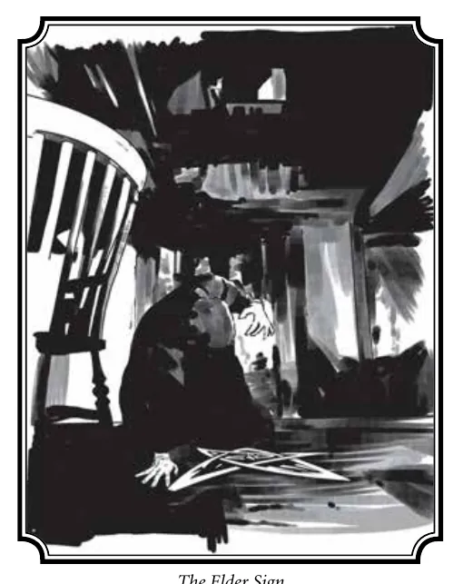

себя? Есть и те, кто не сомневается в её верности городу (ведь её отец в своё время был видным капитаном) и потому гадает, не похитили ли Сару. Такие догадки летают туда-сюда, и по ходу разговора Хранитель может просветить сыщиков насчёт прошлого Сары и её отца в городе — за исключением её занятий магией и связей со Слугами Древних богов, о чём, разумеется, никто не знает.

Если сыщики хотят узнать побольше о городе и о работе гавани, моряки и трактирщик — подходящие люди для расспросов. Они объяснят, что главные ввозимые через город товары — рыба, меха и лес из Исландии и с Балтики, тонкое сукно из Нидерландов и вина из Франции. Главное, что вывозят из города и его окрестностей, — зерно и шерсть-сырец.

Когда моряки начинают расспрашивать сыщиков, зачем те приехали в город (Хранитель, возможно, добавит в их вопросы нотку подозрения: кое-кто гадает, не причастны ли эти чужаки к исчезновению Сары), Генри Скотт приходит в себя и, пошатываясь, подходит к ним. Он объявляет, что сыщики «новые», «не такие» и что их «раньше здесь не было» (см. **«Генри Скотт»**, с. 15).

Если сыщики задержатся здесь слишком долго или сцена начнёт затягиваться, один из моряков встаёт из-за стола и выходит наружу, заявив, что пойдёт облегчиться в канаву. Через пару мгновений он возвращается и поднимает тревогу: на соседней улице горит крыша. Это благодаря Хокинсу (если его не остановили у мельницы) запылал дом Сары. Если сыщики в какой-то момент выйдут, Хранитель может без проверки **Внимания** сообщить им об оранжево-жёлтом зареве пожара над крышами.

## Дом Сары

*Знак Старших богов.*

Скорее всего, сыщиков приведёт сюда то, что, выйдя из Портового трактира, они заметят пожар; или они узнают адрес у Слуг Древних богов; или, увидев пожар в предыдущем витке, попытаются перехватить поджигателя.

Если они отправятся прямо к дому после событий у мельницы или как только перезапустится петля, они успеют сюда прежде, чем Хокинс закончит своё дело. Если они упустили его после погони у мельницы, то могут застать его посреди приготовлений к поджогу. Если ему помешать, он сбежит через заднюю дверь, перелезет через заднюю стену и скроется в лабиринте узких улочек. Если сыщики среагируют достаточно быстро, может начаться погоня. Иначе, чтобы проследить за ним по запутанным переулкам, нужна будет проверка **Чтения следов**. Если сыщикам это удастся, они пройдут за Хокинсом до самого дома Левета.

Тесный домишко Сары — одна из самых ветхих построек на окраине района Дейн. В бедном квартале, не так уж далеко от более зажиточного купеческого, много таких домов. В доме два этажа, спальня — наверху. В доме осталось много вещей её отца (его морское снаряжение и одежда), но видно, что ими давно не пользовались. Если сыщики помешали Хокинсу, здесь можно найти ещё брошенные горшки с маслом, а маслом залиты груды дерева и тканей в нужных местах каждой комнаты. В остальном ничего примечательного здесь не найти.

Весь верхний этаж — спальня Сары. Кровать отодвинута, а часть половиц выломана. Сыщик, которого заинтересуют обломки половиц, заметит на некоторых из них следы ожогов. Чтобы сложить их, нужно несколько минут и успешная проверка **Интеллекта** — и тогда видно, что на этом участке пола был выжжен по дереву странный знак, похожий на пентаграмму. Если у кого-то из сыщиков есть навык **Мифов Ктулху**, он может пройти проверку, чтобы узнать в нём грубый Знак Старших богов. Иначе проверка **Оккультизма** подтвердит, что знак похож на пентаграмму, но в его деталях есть что-то ещё, чего они не узнают. Это, в свою очередь, наводит на мысль о связи с колдовством или хотя бы с языческими верованиями.

Проверка **Интеллекта** позволяет понять: судя по тому, насколько масло впиталось в стены и вещи, по сравнению с повреждениями половиц, половицы, скорее всего, выломали раньше в тот же день,
