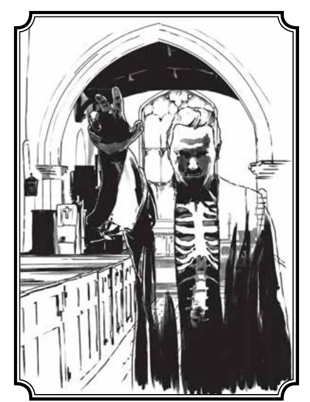

*Призрак нападает!*

Как сказано на с. 14, призрак ничего не предпринимает против сыщиков, если только они не попытаются спуститься в склеп. В склеп ведёт винтовая лестница за дверью позади кафедры. Та же лестница ведёт и наверх, на вершину башни.

Склеп окутан тьмой. Вдоль наружных стен тянутся ниши, в которых покоятся старые гробы. Посреди склепа, прямо под купелью, лежит каменная плита, положенная отцом Финчем, с резным изображением трёх корон на щите. Чтобы поднять каменную плиту, нужна СИЛ 100 (если пытается один сыщик, скорее всего, нужна чрезвычайная проверка **СИЛ**), хотя несколько сыщиков могут попытаться сдвинуть плиту сообща (сложив свою СИЛ, чтобы снизить сложность).

Под плитой — голая земля, в которой зарыта корона. Копать рыхлую землю довольно легко; корона зарыта на глубине 30 см.

Корона сделана из цельного потемневшего серебра и украшена самоцветами, старинными инталиями и камеями. Работа простая, почти грубая, напоминающая короны, изображённые на монетах и в рукописях того времени. Успешная проверка **Истории** или **Оценки** подтверждает, что она, скорее всего, изготовлена не позже IX века.

Стоит вынуть корону из земли, как тут же является призрак. Это может привести и к борьбе среди самих сыщиков, если они всерьёз сражаются за обладание короной или за её уничтожение. Чтобы уничтожить корону, нужно нанести ей 20 пунктов урона. Удар короной о камень наносит ей 1d4 урона, а если уронить на неё тяжёлую каменную плиту — 1d8+2 урона. Попытки уничтожить корону навлекают гнев призрака, и он нападает на тех, кто портит корону, прекращая атаки, если сыщики перестают её портить.

Если пастора не убили, то нет и призрака, и некому защитить корону от сыщиков или Слуг Древних богов. Однако если отец Финч в это время с сыщиками, его придётся убедить (трудной проверкой **Обаяния**, **Красноречия**, **Запугивания** или **Убеждения**), что перенести корону — хорошая мысль; призрака же, одержимого единственной целью, можно убедить лишь чрезвычайным успехом. Если сыщики подкрепят свои доводы сведениями, которые, возможно, получили от Финча в одном из прежних витков, снизьте уровень сложности проверки на одну ступень.

По желанию: если сыщики добирались до церкви долгим путём — им пришлось скрываться от городской стражи или в том же витке они шли по другим следам, — они могут прийти, когда Слуги Древних богов сражаются с призраком в церкви. Слуги пытаются бороться со стражем, обнаружив, что их магия на него не действует, и иссыхают, теряя МОЩ от его атак. Уолтер Лукас, услышав шум в церкви, прячется за скамьями, а затем ковыляет в дальний конец церкви и звонит в колокол, зовя на помощь. В витражных окнах начинают мерцать отблески пламени костра Сары. Между ударами колокола слышны её приглушённые крики, и вскоре петля перезапускается.

Возможно, уже увидев эту сцену в одном из прежних витков, сыщики могут попытаться не пустить Кэтрин, Клэр и Натаниэля внутрь. Если Финч жив, Слуги Древних богов изо всех сил постараются войти в церковь и без колебаний убьют Финча, если он встанет у них на пути, — это (снова) порождает его призрак и кончается тем же. Если сыщики скажут троице, что знают, где Сара — на костре во дворе за церковью, — трое оставят всякую мысль войти в церковь и немедленно отправятся спасать подругу.

## Сожжение Сары

Приведя Сару в церковь, объявив её ведьмой и подкрепив обвинения документами, взятыми из её дома, Левет помогает священникам отвести её во двор за церковью, где они складывают костёр, чтобы очистить её душу. Там шестеро священников и Левет.

Как развернётся сцена, зависит от того, как сыщики подойдут к делу и какая у них поддержка. Вот несколько возможных подходов.

Если с сыщиками Слуги Древних богов, те без колебаний сотворят на священников «Гнев веков» (каждый раз выбирая целью пятерых). Так что встреча становится куда более боевой. После
