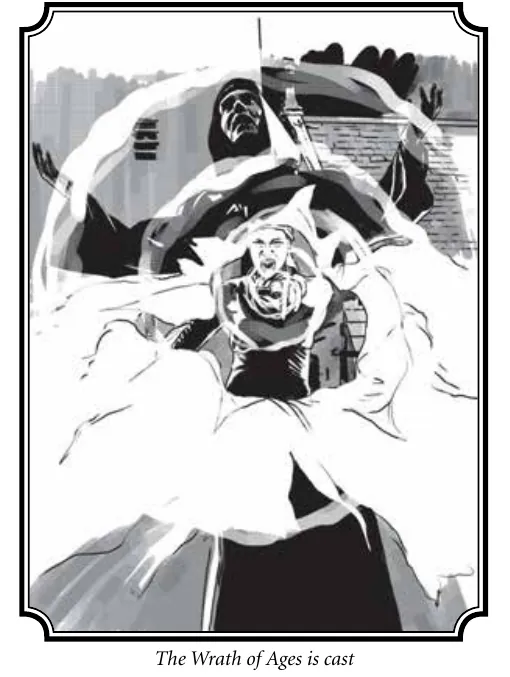

удачного попадания заклинания все выжившие из пяти священников-целей разбегаются, и противостоит сыщикам лишь один. Левет, как сказано в его описании, не боец. Он попытается позвать священников обратно во двор, но, поняв, что никто не возвращается, а противников куда больше, сбежит и сам.

Если с сыщиками отец Финч, сцена становится более дипломатической и менее боевой. Пастор попытается успокоить собратьев-священников, но всё равно нужно, чтобы сыщики убедительно объяснили, почему Сару не следует сжигать. Любые доводы Левет тут же осуждает, и нужна встречная проверка **Убеждения**, чтобы понять, кто склонит священников на свою сторону (у Левета Убеждение 60%):

- Если побеждает Левет, священники тут же поджигают костёр уже горящими факелами.
- Если побеждают сыщики, Финч убеждён и останавливает священников. Левет в ярости бросается вперёд, выхватывает факел у одного из священников и пытается сам поджечь костёр. Чтобы сыщик успел до него добраться, нужна успешная проверка **ЛВК**, а затем проверка **Ближнего боя (драка)**, чтобы остановить его (схватить или сбить с ног), — после чего он сдаётся.

Если сыщики, как только перезапустится петля, отправятся в церковь, не спасая пастора, они намного опередят Слуг Древних богов и потому будут отстаивать своё дело в одиночку. Это тоже встречная проверка **Убеждения** против Левета, чтобы убедить священников, но, раз сыщики — чужаки в странной одежде, без каких-либо поручительств, явившиеся глухой ночью и заявляющие, что пришли забрать ведьму, они получают на проверку штрафную кость.

Если сыщикам не удастся уговорами выпутаться из этого положения, дело вполне может дойти до боя. В этом случае, пока священники и Левет пытаются сдержать сыщиков, один из священников бежит в церковь и начинает звонить в колокол, зовя на помощь. Достаточно, чтобы хоть один священник прошёл проверку **ЛВК** и бросил свой факел на костёр. Тогда Сара возносит свою молитву (см. **«Молитва Сары»**) и, умирая (снова), заканчивает виток.

Если сыщики освободят Сару и объяснят, в каком положении оказались, она будет вне себя от радости, что её молитва услышана (если она успела её произнести; а если нет — что услышана молитва, которую, как она знает, она вознесла бы на последнем вздохе).

Она верно подозревает, что времени у них мало и что им нужно покинуть это место, покинуть царство Древних богов и вернуться в реальный мир. Она быстро уводит сыщиков из города в тёмные поля.

*Гнев веков сотворён.*

> **Молитва Сары**
>
> Прочтите во время сцены у костра Сары, после того как начнёт звонить колокол церкви Святого Варфоломея:
>
> *«Верующие во ложь, внемлите моим словам! Тот, кто есть тьма за ночью. Тот, кто пребывает вне нашей досягаемости. Я взываю к тебе! Ответь на молитву твоей преданной служительницы, да исполнится моё неувядающее желание, моя неумирающая жажда! Колокол, что звонит, знаменует не только мой конец, но и гибель всех вас!»*

## Край мира

Если сыщики выйдут за пределы Данвича и будут идти дальше, они заметят кое-что странное. Чем дальше они от города, тем меньше живности им встречается, а небо будто становится всё темнее. Успешные проверки **Внимания** открывают, что звёзды одна за другой медленно гаснут, чем дальше они уходят. Звёзды снова начинают появляться, только если сыщики идут обратно к Данвичу.

В 8 км от церкви Святого Варфоломея мир попросту исчезает. Видна лишь безграничная пустота вне пространства и времени, как описано в разделе **«Отрицание реальности»** (с. 18). Чувство, что что-то смотрит на них в ответ, и подавляющая сила этого зрелища требуют проверки **Рассудка** (1d3/1d10).
