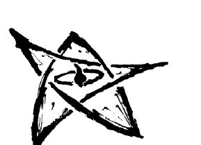

> **Бегство без провожатого**
>
> Сыщики могут оказаться в пустоте без Сары, которая вывела бы их, двумя путями. Либо они могут шагнуть за край мира, если уйдут достаточно далеко от Данвича (это сознательный поступок: сыщики видят, как мир вокруг них осыпается), либо эхо Данвича растворится вокруг них, если следующий виток не сможет начаться (см. **«Конец круга»**, с. 18). Если им не посчастливится оказаться в таком положении, они могут попытаться найти дорогу домой без провожатого или вернуться в Данвич.
>
> По сути, всё происходит так, как описано в разделе **«Край мира»**: нужно тратить пункты магии и проходить проверки **МОЩ**, как сказано выше. Сыщики должны отыскать дорогу домой — им нужно услышать колокол церкви Святого Варфоломея и решить двигаться к нему.
>
> Оказавшись в пустоте, сыщики могут пройти проверку **Слуха**, чтобы услышать вдали звон колокола церкви Святого Варфоломея. При провале они могут попробовать ещё раз, но теперь нужен трудный успех, ведь их относит всё дальше. При необходимости можно сделать последнюю попытку, требующую чрезвычайного успеха. Ни одну из этих проверок нельзя повторить. Если сыщик провалит какую-либо из этих проверок, он может затем попытаться пройти проверку **Внимания** той же сложности, чтобы найти путь обратно к краю мира, ведущему в Данвич. У сыщиков остаётся лишь ещё один шанс: они могут рвануться обратно к Данвичу, что стоит им ещё 1d4 пункта магии. Сыщик, проваливший все попытки покинуть пустоту, потерян и растворяется в ничто.

В невероятно маловероятном случае, если сыщики сумеют найти край мира и без провожатого перебраться через пустоту обратно в реальный мир ещё до первого перезапуска петли, они окажутся там, откуда начинали, — в 1895 году, а буря всё продолжается. Контрабандная операция идёт своим чередом.

В большинстве случаев сыщики (если им удастся вырваться из Данвича) возвращаются в реальный мир после второго, третьего или четвёртого перезапуска. В таких случаях мир, в который они вернулись, оказывается не таким, как они ожидали:

- **Сбежав после первого перезапуска**, сыщики выходят вскоре после полуночи, ранним утром 14 января 1916 года.
- **Сбежав после второго перезапуска**, сыщики выходят вскоре после полуночи, ранним утром 1 февраля 1953 года. Это одна из худших бурь, обрушившихся на Северное море в XX веке: погибло более 2500 человек. В Англии чуть больше 300 человек погибли на побережьях Линкольншира, Норфолка, Саффолка и Эссекса, где пострадало более 1600 км береговой линии и около 24 000 строений получили серьёзные повреждения. В Англии затопило 1000 кв. км прибрежных земель.
- **Сбежав после третьего перезапуска**, сыщики выходят вскоре после полуночи, ранним утром 16 февраля 1962 года. На этот раз буря обрушилась в основном на побережье Германии, но её почувствовали по всему югу Северного моря.
- **Сбежав после четвёртого перезапуска**, сыщики выходят вскоре после полуночи, ранним утром 11 января 1978 года. На этот раз силу бури почувствовали на английском побережье от Хамбера на севере до Кента на юге. Хотя вода поднялась выше, чем в наводнение 1953 года, благодаря улучшенной защите от наводнений прежних опустошений не повторилось, хотя многие пирсы вдоль побережья были сильно повреждены.
- **Сбежав после пятого перезапуска**, сыщики выходят вскоре после полуночи, ранним утром 8 ноября 2007 года. Циклон «Тило» вкупе с и без того высокими приливами вызвал бурю, повредившую побережья Великобритании, Бельгии, Нидерландов, Германии, Дании и Норвегии. Предупреждения о наводнении объявили по всему восточному побережью Британии; сильнее всего пострадали графства Норфолк и Кент.
- **Сбежав после шестого перезапуска**, они выходят вскоре после полуночи 5 декабря 2013 года. Циклон «Бодиль» вызвал сильнейший штормовой нагон за последние 30 лет, затопивший места по всему восточному побережью Англии.

Как уже говорилось о включении сценария в существующую кампанию, Хранитель может отказаться от этих скачков во времени, если использует сценарий как трамплин для продолжающейся кампании. Тогда сыщики просто снова появляются 25 января 1895 года.

Хранители, желающие продолжить игру в 1920-х, могут начать с того, что сыщики выходят в 1916 году (это даст им несколько лет освоиться в новом для них мире), или выбрать придуманную ими самими бурю, ближе к нужной эпохе. Точно так же, чтобы перенести сыщиков в наши дни, можно перескочить к бурям 2007 или 2013 года.

Так или иначе, когда они выйдут — если Сара с ними, — остаётся ещё вопрос, что делать с Сарой…

