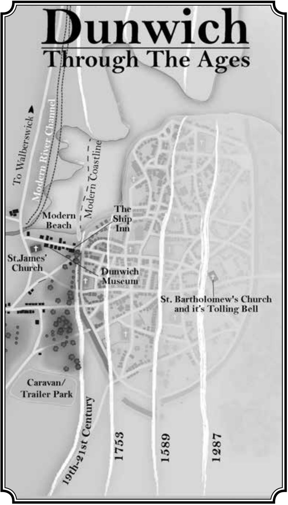

> **Карта «Данвич сквозь века»**
>
> **Подписи на карте:** на Уолберзуик; современное русло реки; современная береговая линия; современный пляж; трактир «Шип-инн»; церковь Святого Иакова; Данвичский музей; церковь Святого Варфоломея и её звонящий колокол; стоянка домов на колёсах (Caravan/Trailer Park); береговые линии: XIX–XXI века, 1753, 1589, 1287.
>
> *Прим. перев.: береговая линия «1753» — см. примечание к введению сборника (с. 5): сам сценарий начинается в 1895 году.*

## Кода: берега будущего

Как видно по карте, к тому времени, когда контрабандисты в 1895 году выгружали на берег свой незаконный груз, море уже забрало почти всё, что когда-то было процветающим городом. Южные районы за Темплом были почти полностью разрушены бурями 1287 и 1328 годов.

С тех пор берег продолжал разрушаться. Скорее всего, сыщики вернутся в начале XX века, когда берег отступил уже до самой церкви Всех Святых: последний угол её башни в 1929 году перенесли на погост церкви Святого Иакова, чтобы и его не забрало море. Хранителю следует представлять, как изменился берег, описывая сцену, которая ждёт сыщиков, когда они выберутся на сушу.

Когда сыщики (и сопровождавшие их ПХ) выберутся на берег, скорее всего, дойдёт до столкновения. Саре неизвестно и безразлично, в какое время она вернулась. Она знает лишь, что в 1287 году умерла, а бури разрушили город. Её смерть утолила её неувядающее желание сокрушить империи богатых в Данвиче, и она считает, что в этом отношении отомстила за отца. Поэтому она готова просто оставить сыщиков в покое, поблагодарив их за то, что они дали ей ещё один шанс на жизнь. Если кто-то из сыщиков воспротивится, может начаться ссора. Если страсти накалятся настолько, что дойдёт до боя, Сара направит заклинание «Гнев веков» на сыщика, возглавляющего нападение на неё. Учитывая сокрушительное действие заклинания, направленного на одну цель, она надеется, что это остановит остальных от нападения.

Считайте, что после бегства из пустоты у Сары осталось 5 пунктов магии, чтобы сотворить это заклинание. У каждого из оставшихся Слуг Древних богов — лишь 1 пункт магии, а если они уже творили это заклинание у церкви, у них осталась половина пунктов здоровья.

Сара (и другие ПХ) просто стоят и ждут, когда сыщики уйдут своей дорогой. Когда между ними окажется достаточно большое расстояние, если кто-то из сыщиков оглянется, Сары (и остальных) уже нет. Разбивающиеся волны моря делают любую попытку пойти по их следам невозможной. Благодаря сыщикам они теперь на свободе в этом мире.

Если кто-то из сыщиков пронёс корону через пустоту, они могут сразиться за её судьбу. В подходящий момент появится призрак Финча и велит сыщикам зарыть корону где-нибудь достаточно далеко от берега, чтобы море больше ей не угрожало. Чтобы побудить сыщиков к этому, он при необходимости прибегнет к насилию. Получив их искреннее заверение, что они снова её зароют, призрак исчезает. Ещё несколько недель после этого всех сыщиков не покидает отчётливое чувство, что за ними наблюдают. Если сыщики попытаются
