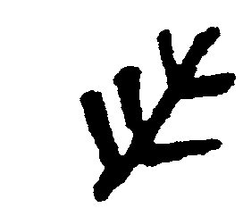

уничтожить корону, призрак явится и будет нападать на них, пока они не изгонят его или не перестанут портить корону. Если корону ему предложат, призрак возьмёт её, тут же исчезнет и спрячет корону в надёжном месте для будущего поколения.

В возможной финальной сцене сыщики пробираются через песчаные дюны — недолгий путь до того, что осталось от Данвича, в какое бы время они ни попали. Единственный свет в этот ночной час горит в трактире «Шип-инн» на Сент-Джеймс-стрит. В зависимости от времени Хранитель может не спеша описать автомобили и другие незнакомые сыщикам изобретения. Дверь трактира открывается: выходит мужчина лет пятидесяти с небольшим, одетый по моде своего времени. Он видит промокших до нитки сыщиков и зазывает их внутрь, прочь от ветра и дождя, пока они, по его словам, «насмерть не простыли». Внутри он возвращается в тепло к стойке, где сыщики могут заметить на стене календарь с датой.

Хранитель приветствует сыщиков в будущем — и на этом сценарий заканчивается.

## Завершение

Предлагаемые награды Рассудка для сыщиков, прошедших этот сценарий:

- не дать уничтожить корону: +1d4 пункта Рассудка;
- уничтожить корону: −1d4 пункта Рассудка;
- вернуть корону призраку: +1d4 пункта Рассудка.

Учтите, что следующая награда зависит от того, как сыщики смотрели на Сару и её поступки. Хранителю следует применить ту награду или тот штраф, что лучше всего отвечает тому, как ваши игроки восприняли Сару — «злую» ведьму или «невинную» ведьму:

- спасти Сару, веря, что её преследовали безвинно: +1d6 пункта Рассудка;
- спасти Сару, веря, что она опасная ведьма: −1d6 пункта Рассудка.



## Приложение A. Персонажи

Приведены лишь нужные и необходимые характеристики. Хранитель может свободно изменять или дополнять их по своему усмотрению.

#### Сара Браун, 29 лет, жрица Древних богов

```stat
СИЛ 50    ВЫН 70    ТЕЛ 45    ЛВК 70    ИНТ 60
НАР 65    МОЩ 80    ОБР 55    Рассудок 40   ПЗ 11
БкУ: 0    Комплекция: 0   Скорость: 9   ПМ: 16

Драка             30% (15/6), урон 1d3 или по оружию
Уклонение         45% (22/9)

Навыки: Мифы Ктулху 20%, Слух 50%, Ориентирование 40%, Убеждение 60%, Пилотирование (лодка) 60%, Внимание 50%, Скрытность 40%, Плавание 70%.

Заклинания: Сара знает «Гнев веков» (с. 11), «Собрать изобилие моря» (с. 26) и, на усмотрение Хранителя, может знать ещё 1d6 заклинаний.
```

#### Кэтрин Даунинг, 32 года, служительница Древних богов

```stat
СИЛ 45    ВЫН 60    ТЕЛ 55    ЛВК 50    ИНТ 65
НАР 60    МОЩ 75    ОБР 60    Рассудок 30   ПЗ 11
БкУ: 0    Комплекция: 0   Скорость: 6   ПМ: 15

Драка             30% (15/6), урон 1d3 или по оружию
Уклонение         40% (20/8)

Навыки: Мифы Ктулху 30%, Слух 40%, Ориентирование 35%, Внимание 45%, Скрытность 60%, Плавание 35%.

Заклинания: Кэтрин знает «Гнев веков» (с. 11) и, на усмотрение Хранителя, может знать ещё 1d6 заклинаний.
```

*Прим. перев.: Скорость 6 — как в оригинале; по правилам (СИЛ и ЛВК меньше ТЕЛ, возраст 32) выходит 7.*

#### Клэр Бун, 22 года, служительница Древних богов

```stat
СИЛ 50    ВЫН 55    ТЕЛ 50    ЛВК 60    ИНТ 60
НАР 55    МОЩ 70    ОБР 55    Рассудок 30   ПЗ 10
БкУ: 0    Комплекция: 0   Скорость: 7   ПМ: 14

Драка             35% (17/7), урон 1d3 или по оружию
Уклонение         50% (25/10)

Навыки: Мифы Ктулху 25%, Слух 60%, Ориентирование 40%, Внимание 50%, Скрытность 45%, Плавание 40%.

Заклинания: Клэр знает «Гнев веков» (с. 11) и, на усмотрение Хранителя, может знать ещё 1d6 заклинаний.
```

*Прим. перев.: Скорость 7 — как в оригинале; по правилам (СИЛ равна ТЕЛ, ЛВК больше ТЕЛ, возраст 22) выходит 8.*

#### Натаниэль Холл, 26 лет, служитель Древних богов

```stat
СИЛ 55    ВЫН 50    ТЕЛ 55    ЛВК 65    ИНТ 60
НАР 50    МОЩ 60    ОБР 50    Рассудок 45   ПЗ 10
БкУ: 0    Комплекция: 0   Скорость: 7   ПМ: 12

Драка             40% (20/8), урон 1d3 или по оружию
Уклонение         45% (22/9)
```
