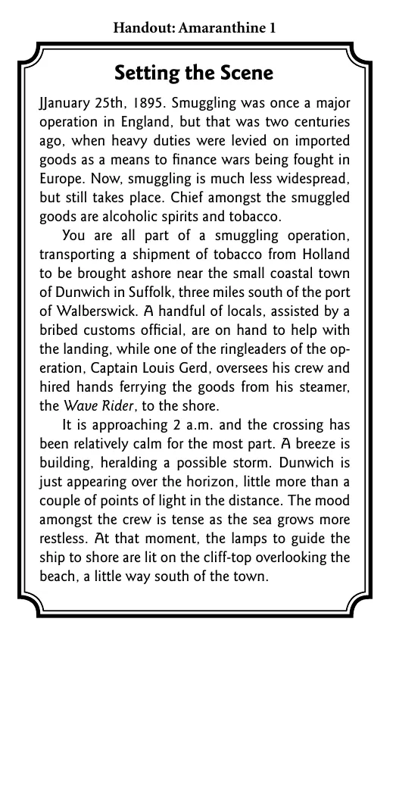
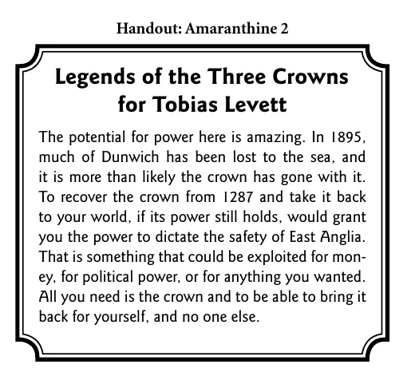
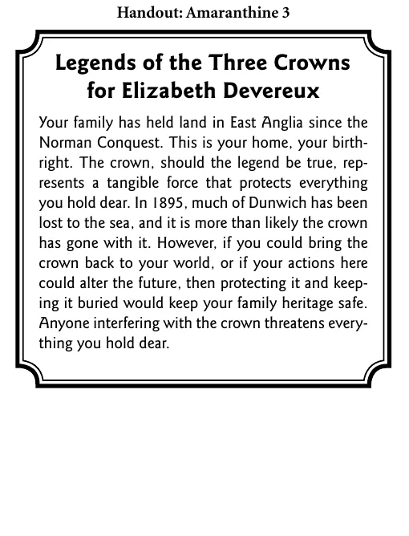

## Приложение B. Раздатки

*Ниже — каждая раздатка в оригинале (картинкой, для печати) и её перевод.*

### Раздатка «Неувядающее желание» 1

> **Раздатка «Неувядающее желание» 1**
>
> **Место действия**
>
> 25 января 1895 года. Когда-то контрабанда была в Англии крупным делом, но это было два века назад, когда ввозимые товары облагали высокими пошлинами, чтобы оплачивать войны в Европе. Теперь контрабанда куда менее распространена, но всё ещё существует. Главные контрабандные товары — крепкие спиртные напитки и табак.
>
> Все вы — участники контрабандной операции: везёте партию табака из Голландии, чтобы выгрузить её на берег близ маленького прибрежного городка Данвич в Саффолке, почти в пяти километрах к югу от порта Уолберзуик. Горстка местных при помощи подкупленного таможенника готова помочь с высадкой, а один из главарей операции, капитан Луис Герд, руководит своей командой и нанятыми людьми, переправляющими груз с его парохода «Уэйв Райдер» на берег.
>
> Близится 2 часа ночи, и переход был в основном довольно спокойным. Крепчает ветер, предвещая бурю. Данвич только показывается над горизонтом — пара огоньков вдали. Команда напряжена: море становится всё беспокойнее. В этот миг на вершине обрыва над берегом, чуть южнее городка, зажигают фонари, указывающие судну путь к берегу.

### Раздатка «Неувядающее желание» 2

> **Раздатка «Неувядающее желание» 2**
>
> **Легенды трёх корон**
>
> **для Тобайаса Левета**
>
> Какие возможности для власти! В 1895 году бо́льшая часть Данвича уже поглощена морем, и корона, скорее всего, ушла вместе с ним. Добыть корону в 1287 году и унести её в свой мир — если её сила ещё действует — значит получить власть решать, будет ли Восточная Англия в безопасности. Это можно обратить в деньги, в политическую власть — во что угодно. Нужна лишь корона и возможность унести её с собой — для себя, и ни для кого другого.

### Раздатка «Неувядающее желание» 3

> **Раздатка «Неувядающее желание» 3**
>
> **Легенды трёх корон**
>
> **для Элизабет Деверо**
>
> Твоя семья владеет землёй в Восточной Англии со времён Нормандского завоевания. Это твой дом, твоё право по рождению. Корона, если легенда правдива, — ощутимая сила, которая защищает всё, что тебе дорого. В 1895 году бо́льшая часть Данвича уже поглощена морем, и корона, скорее всего, ушла вместе с ним. Но если бы ты могла унести корону в свой мир или если бы твои поступки здесь могли изменить будущее, то, сберегая её и оставив её в земле, ты сохранила бы наследие своей семьи. Всякий, кто посягает на корону, угрожает всему, что тебе дорого.
