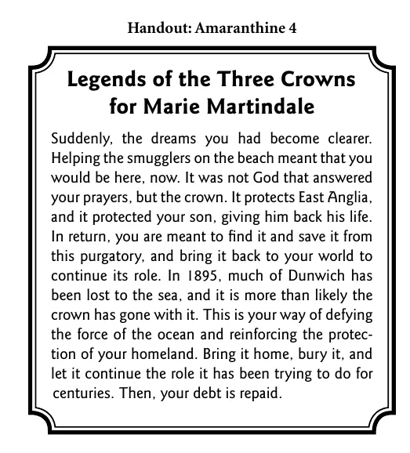
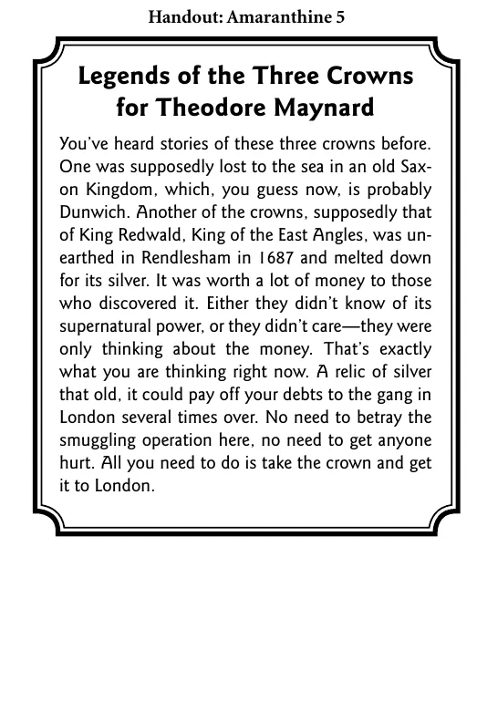

### Раздатка «Неувядающее желание» 4

> **Раздатка «Неувядающее желание» 4**
>
> **Легенды трёх корон**
>
> **для Мари Мартиндейл**
>
> Внезапно твои сны становятся яснее. Помогая контрабандистам на берегу, ты должна была оказаться здесь, сейчас. На твои молитвы ответил не Бог, а корона. Она защищает Восточную Англию — и защитила твоего сына, вернув ему жизнь. Взамен ты должна найти её, спасти из этого чистилища и унести в свой мир, чтобы она и дальше исполняла своё назначение. В 1895 году бо́льшая часть Данвича уже поглощена морем, и корона, скорее всего, ушла вместе с ним. Так ты бросишь вызов силе океана и укрепишь защиту родной земли. Принеси её домой, закопай и позволь ей исполнять то, что она пытается делать веками. Тогда твой долг будет уплачен.

### Раздатка «Неувядающее желание» 5

> **Раздатка «Неувядающее желание» 5**
>
> **Легенды трёх корон**
>
> **для Теодора Мейнарда**
>
> Ты уже слышал истории об этих трёх коронах. Одна будто бы ушла в море вместе со старым саксонским королевством — теперь ты догадываешься, что это, вероятно, Данвич. Другую, будто бы корону короля Редвальда, короля восточных англов, выкопали в Рендлшеме в 1687 году и переплавили на серебро. Тем, кто её нашёл, она принесла кучу денег. То ли они не знали о её сверхъестественной силе, то ли им было всё равно — они думали только о деньгах. Именно об этом ты сейчас и думаешь. Серебряная реликвия такой древности могла бы несколько раз покрыть твои долги лондонской шайке. Не нужно предавать здешнюю контрабанду, не нужно, чтобы кто-то пострадал. Нужно лишь взять корону и доставить её в Лондон.

### Раздатка «Неувядающее желание» 6

> **Раздатка «Неувядающее желание» 6**
>
> **Легенды трёх корон**
>
> **для Эммануэль Больё**
>
> В 1895 году бо́льшая часть Данвича уже поглощена морем, и корона, скорее всего, ушла вместе с ним. Но ведь сейчас не 1895 год. Может, корона всё ещё творит своё колдовство там, в море? Может, твои поступки в 1287 году изменят будущее? А что, если кто-то попытается унести корону в твой мир, чтобы восстановить там её силу? Вот случай, которого ты ждала. Ты можешь нанести Англии настоящий удар, ослабив её защиту на случай, если когда-нибудь начнётся вторжение. Нужно лишь уничтожить корону или хотя бы позаботиться, чтобы она не вернулась с тобой. Всё просто — и ты наконец сможешь вкусить настоящую месть.

*Прим. перев.: в заголовке раздатки в оригинале — «for Emmanuel Beaulieu»; в остальной книге имя сыщика — Emmanuelle.*

### Раздатка «Неувядающее желание» 7

> **Раздатка «Неувядающее желание» 7**
>
> **Легенды трёх корон**
>
> **для Ричарда Гаррета**
>
> Твоя семья, как и семья Элизабет, веками живёт в Восточной Англии. Это твой дом, твоё право по рождению. Корона, если легенда правдива, — ощутимая сила, которая защищает всё, что тебе дорого. В 1895 году бо́льшая часть Данвича уже поглощена морем, и корона, скорее всего, ушла вместе с ним. Но если бы ты мог унести корону в свой мир или если бы твои поступки здесь могли изменить будущее, то, сберегая её и оставив её в земле, ты сохранил бы наследие своей семьи. Всякий, кто посягает на корону, угрожает всему, что дорого тебе и Элизабет.
