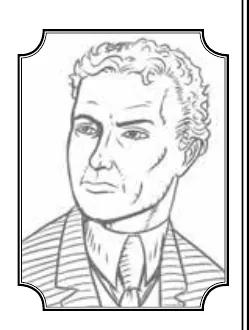

### Тобайас Левет, таможенный чиновник, 35 лет



```stat
СИЛ 40    ВЫН 60    ТЕЛ 50    ЛВК 50    ИНТ 80
НАР 50    МОЩ 60    ОБР 70    Рассудок 60   ПЗ 11
БкУ: 0    Комплекция: 0   Скорость: 8   Удача: 55

Драка             40% (20/8), урон 1d3
Уклонение         40% (20/8)

Навыки: Оценка 25%, Средства 60%, Красноречие 70%, История 40%, Прыжки 40%, Ориентирование 30%, Убеждение 50%, Психология 50%, Ловкость рук 30%, Внимание 60%, Скрытность 50%.
```

**Предыстория:**

- **Описание:** среднего сложения, хорошо одет, кудрявый.
- **Черты:** самодоволен, держится с достоинством.

Вы уроженец Саффолка и родились в богатой семье купцов-импортёров из Бери-Сент-Эдмундса. Вы никогда всерьёз не думали, что вам придётся зарабатывать на жизнь, — за вас это делали другие. Вы вполне довольствовались занятиями, далёкими от дела. Страстный любитель истории, вы даже подумывали об учёной карьере, пока события не взяли над вами верх.

Ввозные пошлины росли и всё сильнее били по семейному делу. Ввоз таких товаров, как табак, с континента становился разорительным. Нужно было что-то предпринять. Ваш отец Джонатан, никогда особо не одобрявший ваших учёных занятий, пустил в ход связи в местных властях и устроил вас таможенным чиновником. Вас поставили надзирать за работой разных портов на побережье Саффолка.

Неудивительно, что вы возненавидели своё положение. Однако со временем, когда вы заслужили репутацию верного и толкового чиновника, отец открыл вам настоящую причину, по которой вас посадили на эту должность. Он знал контрабандистов в Голландии, которые могли доставлять для него товары в Англию. Если платить вам за то, чтобы власти в нужное время смотрели в другую сторону от нужных мест, высадки могли состояться, а семья наживалась бы и на взятках, и на уклонении от пошлин. С тех пор вы берёте взятки, а доходы семьи взлетели.

Это устройство дел пробудило в вас вкус к власти, и вам не терпится получить её ещё больше. В каком-то смысле вы — подтверждение поговорки «власть развращает», хотя сами вы считаете это не развращённостью, а просто делом.

**Ваши спутники:**

- **Элизабет Деверо:** представительница видного рода Восточной Англии, владеющего большими землями. Она платит вам взятку за контрабандную операцию. Вы гадаете, много ли (и знает ли вообще) она о связи вашей семьи с контрабандистами. Опасна ли она?
- **Мари Мартиндейл:** жена местного фермера; она пришла к вам и предложила помочь с парой последних высадок. Вы гадаете, зачем ей это: деньги, которые она получает, её, похоже, совсем не интересуют.
- **Теодор Мейнард:** мелкий преступник из Лондона, работающий с контрабандистами из Голландии. Вы его плохо знаете.
- **Эммануэль Больё:** французская моряк; она годами занимается контрабандой и почему-то, похоже, глубоко не любит англичан. Несмотря на её вспыльчивость, она вам вполне нравится.
- **Ричард Гаррет:** бывший егерь, ставший наёмной «грубой силой» у контрабандистов, чтобы заработать на жизнь. В душе хороший человек.
