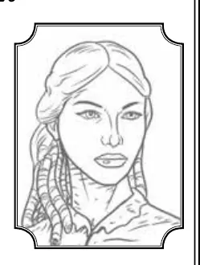

### Элизабет Деверо, светская дама, 20 лет



```stat
СИЛ 50    ВЫН 40    ТЕЛ 50    ЛВК 50    ИНТ 60
НАР 70    МОЩ 60    ОБР 80    Рассудок 60   ПЗ 9
БкУ: 0    Комплекция: 0   Скорость: 8   Удача: 50

Драка             40% (20/8), урон 1d3
Уклонение         40% (20/8)

Навыки: Обаяние 35%, Средства 70%, Красноречие 50%, История 60%, Язык (латынь) 25%, Оккультизм 25%, Убеждение 40%, Пилотирование (лодка) 21%, Психология 60%, Внимание 50%, Скрытность 50%.
```

**Предыстория:**

- **Описание:** красавица в лихом наряде авантюристки, с длинными распущенными волосами.
- **Черты:** изящна и уверена в себе.

Семья Деверо владеет землёй в Саффолке со времён Нормандского завоевания. В детстве семейное богатство давало вам всё необходимое. Вы получили первоклассное образование, у вас собственное поместье неподалёку от Саксмандема, выбор любого мужчины, какого пожелаете, и обеспеченное будущее. Из-за всего этого вы скучали бо́льшую часть детства, и это состояние не покинуло вас и во взрослой жизни.

Деньги давали вам всё, что нужно, но не то, чего хотелось. Вам хотелось жить, переживать приключения и волнения, но семья не потакала вам. Не имея возможности узнать мир своими глазами, вы узнавали его через науку: читали историю, а в последние годы обратились к более эзотерическим предметам.

Отчасти в знак бунта против семьи, отчасти чтобы добавить в жизнь настоящего волнения, вы заплатили за знакомства в мире организованной преступности и вышли на контрабандистов в Голландии. Сначала вы финансировали их операции за долю в прибыли, но недавно взялись и сами помогать с высадками контрабанды на побережье Саффолка. Азарт дела и риск попасться дают вам почувствовать себя живой, как не чувствовали годами. Кроме подкупленных вами таможенников и главарей контрабандной шайки, мало кто знает, насколько вы в это вовлечены и кто вы такая. Для всех остальных вы просто ещё одна наёмная работница, желающая быстро заработать. Вам это нравится.

**Ваши спутники:**

- **Тобайас Левет:** таможенный чиновник, которого вы подкупили, чтобы власти не смотрели на побережье Данвича, когда сегодня ночью придёт груз. Покопавшись, вы выяснили, что его семья ведёт ввозную торговлю в Бери-Сент-Эдмундсе. Его отец, Джонатан Левет, немало нажился на товарах, ввезённых в страну контрабандой. Получая от вас взятки, его семья неплохо устроилась. Эти сведения можно обменять у властей на свободу, если вас поймают, подкинув им рыбу покрупнее.
- **Мари Мартиндейл:** жена местного фермера, помогавшая разгружать пару последних партий груза близ Данвича. Она кажется очень целеустремлённой, почти встревоженной чем-то — но чем?
- **Теодор Мейнард:** мелкий преступник; ваши знакомые говорят, что у него большие долги в Лондоне. Если он скоро не расплатится наличными, ему, возможно, придётся платить кровью. При необходимости этим можно воспользоваться.
- **Эммануэль Больё:** давняя французская контрабандистка, которая, похоже, ненавидит всех англичан. Вы держитесь от неё подальше.
- **Ричард Гаррет:** егерь, уволенный за то, что позволял голодающим браконьерам охотиться в поместье вашего отца. Его репутация погублена, и вы наняли его «грубой силой» к контрабандистам. Он на пятнадцать лет старше вас и, сколько вы себя помните, с самого детства был вам верным другом. Он один из немногих ваших настоящих друзей и никогда вас не предаст.
