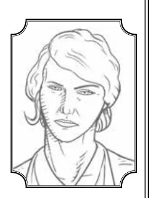

### Мари Мартиндейл, жена фермера, 25 лет



```stat
СИЛ 60    ВЫН 80    ТЕЛ 40    ЛВК 70    ИНТ 60
НАР 50    МОЩ 50    ОБР 50    Рассудок 50   ПЗ 12
БкУ: 0    Комплекция: 0   Скорость: 9   Удача: 45

Драка             50% (25/10), урон 1d3
Уклонение         35% (17/7)

Навыки: Лазание 60%, Средства 40%, Первая помощь 50%, История 25%, Запугивание 40%, Слух 70%, Оккультизм 25%, Пилотирование (лодка) 50%, Верховая езда 40%, Выживание 30%, Плавание 60%, Метание 50%.
```

**Предыстория:**

- **Описание:** невысокая, в одежде фермерши, крепкая.
- **Черты:** добрая и набожная.

Жизнь жены фермера полна тяжёлого труда, но это хорошая жизнь. У вас ферма у самого Данвича, любящий муж и чудесный сын Джеймс. Три месяца назад Джеймс пришёл домой и рассказал, что море забрало ещё кусок утёса и обнажило старые могилы. Море понемногу съедает городок Данвич, включая землю, где когда-то стояли церкви. Джеймс играл на берегу и нашёл среди выброшенных морем обломков металлическое распятие. Похоже, когда-то, прежде чем его похоронили с покойником, оно побывало в огне. Джеймс хотел, чтобы вы спустились и посмотрели на всё сами, но вам это показалось слишком жутким, и вы уговаривали его остаться дома. Он не послушался. Может быть, пойди вы с ним, всё было бы иначе.

Вскоре вам принесли весть: Джеймс вернулся на берег поискать ещё сокровищ, и тут часть утёса обвалилась, и камни рухнули на него. У него был раздавлен позвоночник. Даже если бы он каким-то чудом выжил, ходить он бы уже никогда не смог. Его принесли домой, и все ждали, что ночью он умрёт. Вы взяли найденное им распятие, вышли в ночь к утёсам и молились за него при свете луны. Вы сказали Богу, что сделаете что угодно, если Он пощадит вашего сына. Под шум волн и далёкий звон — как вам показалось, церковного колокола — вы задремали на вершине утёса. В ту ночь вам приснилось много странного. Вы видели, как помогаете мужчинам и женщинам разгружать груз на берегу; корону, поблёскивающую во тьме; слышали крик женщины, и вокруг вас вздымался огонь; видели священника в капюшоне, который стоял в дверях церкви и манил вас внутрь, пока колокол звонил снова.

Муж нашёл вас и сказал, что случилось чудо. Джеймс поправился, отделавшись едва ли не одними синяками. Видимо, врач ошибся с диагнозом. Вы знаете, что это не так, и с тех пор всегда носите распятие с собой. Вы узнали кое-кого из людей, разгружавших груз в видении, и обнаружили контрабандную операцию близ Данвича. Вы убеждены, что видение — задание, посланное вам Богом, чтобы отплатить Ему за чудо. Сегодня ночью вы узнаете, чего Он от вас хочет.

**Ваши спутники:**

- **Тобайас Левет:** продажный таможенный чиновник, которого подкупили. Вы уговорили его позволить вам помогать с высадками.
- **Элизабет Деверо:** новенькая в шайке контрабандистов. Она не похожа на человека, который ввязывается в такие дела.
- **Теодор Мейнард:** мелкий преступник из Лондона. Однажды язык доведёт его до беды…
- **Эммануэль Больё:** давняя контрабандистка. Вы чувствуете, что когда-то её сердце было разбито и наполнилось яростью, — но как?
- **Ричард Гаррет:** бывший егерь, ставший наёмной «грубой силой» у контрабандистов. Хороший человек с золотым сердцем.
