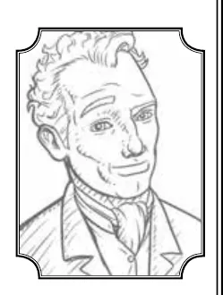

### Теодор Мейнард, преступник, 27 лет



```stat
СИЛ 50    ВЫН 60    ТЕЛ 50    ЛВК 80    ИНТ 70
НАР 60    МОЩ 40    ОБР 50    Рассудок 40   ПЗ 11
БкУ: 0    Комплекция: 0   Скорость: 8   Удача: 40

Драка             60% (30/12), урон 1d3
Уклонение         40% (20/8)

Навыки: Оценка 25%, Лазание 40%, Средства 15%, Красноречие 40%, Запугивание 70%, Слух 60%, Пилотирование (лодка) 40%, Верховая езда 50%, Ловкость рук 30%, Скрытность 40%, Плавание 50%, Метание 40%.
```

**Предыстория:**

- **Описание:** высокий, стройный, кудрявый, в рубашке с жабо и длинном сюртуке.
- **Черты:** обаятельный и симпатичный плут.

Вы родились в бедной семье почти без надежды на образование и хватались за любую работу. Почти всегда это был ручной труд. Перебиваясь разными заработками, вы нашли работу на складах в лондонских доках, и там связались с преступными шайками. Отчаянно нуждаясь в любых деньгах, вы время от времени помогали воровать со складов и сбывали вещи на чёрном рынке. Это приносило вам неплохие деньги, а переходя с одной работы на другую, вы нигде не задерживались настолько, чтобы попасться. А потом вы совершили ошибку — обокрали организованных преступников. Знай вы, что тем складом пользуются контрабандисты, вы бы его и пальцем не тронули. Но наводка о хранящемся там грузе была слишком соблазнительной, чтобы её упустить. Благодаря своей сети знакомств они быстро нашли вас и поставили перед выбором.

Главарь контрабандной шайки хотел сделать из вас пример: жуткая смерть, о которой узнают все, гарантировала бы, что никто не станет мешать их делу из страха разделить вашу участь. Однако вас спас ваш характер. До тех пор язык доставлял вам немало неприятностей — вы вечно отпускаете остроту там, где она не нужна, — но вы быстро соображали, и это вас выручило. Вы пообещали, что сможете вернуть контрабандистам стоимость потерянного товара в десятикратном размере. Как? Выдав им добычу другой операции, которая, как вы знали, через несколько недель должна высадиться на побережье Саффолка.

Несколько дней назад вам предложили отплыть вместе с ними из Голландии. Вы поможете провести высадку, получите плату, сообщите контрабандистам в Лондоне, где спрятан груз, и они получат огромную прибыль. Лёгкие деньги. Но если вы попытаетесь их обмануть, они придут за вашей головой. Никакого давления.

**Ваши спутники:**

- **Тобайас Левет:** таможенный чиновник, которому заплатили, чтобы высадка прошла гладко. Хитрец, и доверять ему нельзя.
- **Элизабет Деверо:** вы неплохо разбираетесь в людях. Вы почти уверены, что она дама из высшего общества, выдающая себя за контрабандистку, но пока её не выдали. Что она делает в такой компании? Чего она хочет?
- **Мари Мартиндейл:** жена местного фермера — она совсем не похожа на контрабандистку, но очень настойчиво рвётся помогать.
- **Эммануэль Больё:** давняя контрабандистка родом с севера Франции. Почему-то она ненавидит англичан. Сила её ненависти порой вас пугает. По возможности вы держитесь от неё подальше.
- **Ричард Гаррет:** бывший егерь, которому пришлось наняться «грубой силой». Вам кажется, что он как-то знаком с Деверо. Между ними определённо есть связь.
