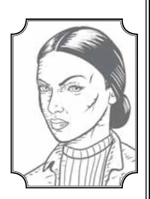

### Эммануэль Больё, контрабандистка, 33 года



```stat
СИЛ 50    ВЫН 70    ТЕЛ 50    ЛВК 60    ИНТ 60
НАР 40    МОЩ 80    ОБР 50    Рассудок 80   ПЗ 12
БкУ: 0    Комплекция: 0   Скорость: 8   Удача: 65

Драка             60% (30/12), урон 1d3
Уклонение         70% (35/14)

Навыки: Средства 50%, Красноречие 40%, Запугивание 35%, Язык (английский) 40%, Ориентирование 30%, Убеждение 60%, Пилотирование (лодка) 40%, Психология 30%, Ловкость рук 30%, Внимание 50%, Скрытность 50%.
```

**Предыстория:**

- **Описание:** когда-то красавица, а теперь почти призрачная на вид. Широко раскрытые тёмные глаза, чуть впалые щёки. Одета в практичную морскую одежду.
- **Черты:** высокомерна, страстно ненавидит Англию.

Вы выросли на северном побережье Франции, в маленькой рыбацкой общине, но при первой возможности перебрались в Кале, чтобы найти работу в городе покрупнее. Там вы встретили будущего мужа, Алана. Он был моряком торгового флота. Расцвела любовь, и он позвал вас жить к себе домой, в Саутгемптон.

Вас обоих роднила любовь к морю. Казалось, вы нашли родственную душу. Однако с самого начала было ясно, что остальная семья Алана вас невзлюбила. Между англичанами и французами всегда было соперничество, и они просто не принимали вас такой, какая вы есть. И не только они ненавидели соседей из-за Ла-Манша.

Однажды ночью Алан вернулся домой жестоко избитым. На него напали моряки из доков. Они сказали ему, что если он женится на француженке, ему здесь не место. Он не послушал их, и через пару недель после свадьбы его снова избили. Второго нападения он не пережил. Его нашли плавающим в доке, всё тело было в синяках и переломах.

Вас сломило горе. Английским громилам не нужно было его убивать. И всё лишь потому, что он женился на женщине своей мечты, а она оказалась француженкой. Ваше сердце полно гнева, который горит и по сей день, спустя восемь лет.

Не желая оставаться в Англии, вы вернулись на континент. Используя свои умения, вы обратились к преступлению. Контрабанда была очень доходным делом, а ваше мастерство на море — ведь вы выросли в рыбацкой общине — очень ценилось. Это принесло вам немало денег, а подрывать Англию любым способом вам в радость. Если бы вы могли нанести Англии удар посерьёзнее, вы бы так и сделали. А пока сойдёт и это…

**Ваши спутники:**

- **Тобайас Левет:** таможенник, которому заплатили, чтобы высадки у Данвича могли состояться. Предатель англичан — он заслужил хоть каплю вашего уважения. И всё же он англичанин.
- **Элизабет Деверо:** ещё одна женщина в команде. Опыта на море у неё, похоже, немного, и на преступницу она не похожа. Зачем она здесь на самом деле? Вы её подозреваете.
- **Мари Мартиндейл:** местная жительница Данвича, помогающая контрабандистам. Она, похоже, очень набожна: вы видели, как бережно она хранит распятие на шее. Деньги, похоже, её не особенно волнуют, так что же она здесь делает?
- **Теодор Мейнард:** мелкий преступник с длинным языком. Вы слышали, что у него долги в Лондоне. Видимо, он надеется, что контрабанда поможет ему расплатиться.
- **Ричард Гаррет:** бывший егерь, которому пришлось встать на путь преступления, потому что другой работы ему не найти. Вам его жаль. Хороший человек в ужасном мире.
