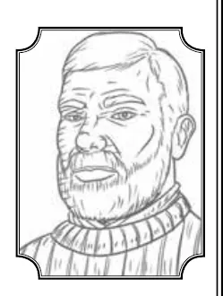

### Ричард Гаррет, егерь, 35 лет



```stat
СИЛ 80    ВЫН 60    ТЕЛ 70    ЛВК 60    ИНТ 50
НАР 50    МОЩ 50    ОБР 40    Рассудок 50   ПЗ 13
БкУ: +1d4   Комплекция: 1   Скорость: 9   Удача: 40

Драка             70% (35/14), урон 1d3+БкУ
Уклонение         30% (15/6)

Навыки: Лазание 50%, Средства 25%, Первая помощь 50%, Запугивание 60%, Слух 50%, Ориентирование 30%, Пилотирование (лодка) 50%, Верховая езда 40%, Выживание 30%, Плавание 40%, Метание 60%, Чтение следов 30%.
```

*Прим. перев.: Скорость 9 — как в оригинале; по правилам (СИЛ больше ТЕЛ, ЛВК меньше ТЕЛ, возраст 35) выходит 8.*

**Предыстория:**

- **Описание:** одет в тёплую одежду для жизни под открытым небом, густая борода, обветренное лицо.
- **Черты:** справедлив и практичен.

Ваш отец, а до него и его отец служили семье Деверо: ухаживали за её землями и охраняли её дичь. Семья владеет землёй в Саффолке со времён Нормандского завоевания и в основном хорошо обходилась с людьми. Вы были подростком и учились всему, что нужно, чтобы сменить отца на посту егеря и смотрителя поместья, когда родилась Элизабет Деверо. Вы видели, как она росла и стала прекрасной дамой, которой однажды достанется огромное семейное богатство. Вы дружите с ней с тех пор, как она научилась ходить: показывали ей поместье и сближали с природой.

Жизнь была спокойной и надёжной, пока перед вами не встала задача, от которой не уйти. Вы поймали на браконьерстве Джеймса Тёрнера — местного семьянина, жившего с семьёй сразу за границей поместья Деверо близ Саксмандема. Он был батраком, давно сидел без работы и с трудом кормил жену и двоих детей. Ему приходилось браконьерствовать, иначе они умерли бы с голоду. Вы закрыли на это глаза, чтобы спасти его семью, но когда это дошло до хозяина дома, тот пришёл в ярость. Сочтя себя преданным, он прогнал вас. Этот случай погубил вашу репутацию, и с тех пор найти работу почти невозможно.

Недавно вас выручила Элизабет. В поисках волнения она начала работать с контрабандистами на побережье Саффолка. Азарт и опасность дают ей почувствовать себя живой. Желая помочь одному из немногих своих друзей, она платит вам за помощь. Вы получаете и долю прибыли, так что жить вам стало несравнимо лучше. Взамен вы следите, чтобы с ней не случилось беды.

**Ваши спутники:**

- **Тобайас Левет:** продажный таможенный чиновник, которому заплатили, чтобы высадка состоялась. Может, дело в том, что его можно купить, но что-то в нём заставляет вас ему не доверять.
- **Элизабет Деверо:** дочь вашего прежнего хозяина; она спасла вас от нищеты. Вы заботитесь о ней почти как о сестре, которой у вас никогда не было. Вы многим ей обязаны и не дадите её в обиду.
- **Мари Мартиндейл:** жена местного фермера. Вы слышали, что её сын недавно чудесным образом оправился после страшного падения с утёсов у Данвича. Думали, что он никогда больше не сможет ходить, но он поправился. С тех пор она очень набожна. Вам кажется, что она помогает контрабандистам не по своему выбору, а скорее из какого-то долга.
- **Теодор Мейнард:** мелкий преступник, примкнувший к контрабандной операции, чтобы расплатиться с долгами в Лондоне. Язык порой доводит его до беды, но в остальном он безобидный плут.
- **Эммануэль Больё:** давняя французская контрабандистка, которая, похоже, ненавидит всех англичан. Очень немногие знают правду о том, что Элизабет участвует в операции. Если Эммануэль узнает, полетят искры. Вы внимательно за ней следите.
