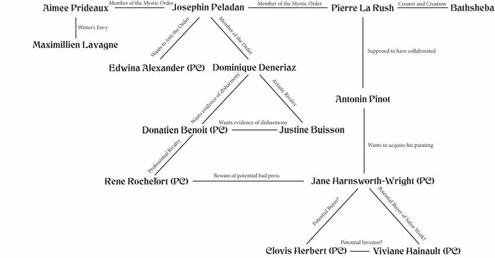

## Карта связей

Подписи схемы (сыщик — готовый сыщик игрока):

| Кто | С кем | Связь |
|---|---|---|
| Эме Придо | Жозефен Пеладан | члены Мистического ордена |
| Жозефен Пеладан | Пьер Ла Раш | члены Мистического ордена |
| Пьер Ла Раш | Вирсавия | создатель и создание |
| Эме Придо | Максимильен Лавань | зависть писателя |
| Жозефен Пеладан | Эдвина Александер (сыщик) | хочет вступить в орден |
| Жозефен Пеладан | Доминик Денерьяз | член ордена |
| Пьер Ла Раш | Антонен Пино | должны были работать вместе |
| Доминик Денерьяз | Жюстин Бюиссон | творческое соперничество |
| Доминик Денерьяз | Донасьен Бенуа (сыщик) | ищет свидетельства разлада |
| Донасьен Бенуа (сыщик) | Жюстин Бюиссон | ищет свидетельства разлада |
| Донасьен Бенуа (сыщик) | Рене Рошфор (сыщик) | профессиональное соперничество |
| Антонен Пино | Джейн Харнсворт-Райт (сыщик) | хочет купить его картину |
| Рене Рошфор (сыщик) | Джейн Харнсворт-Райт (сыщик) | берегись дурной прессы |
| Джейн Харнсворт-Райт (сыщик) | Кловис Эрбер (сыщик) | возможная покупательница? |
| Джейн Харнсворт-Райт (сыщик) | Вивиан Эно (сыщик) | возможная покупательница работ Салона? |
| Кловис Эрбер (сыщик) | Вивиан Эно (сыщик) | возможная вкладчица? |
