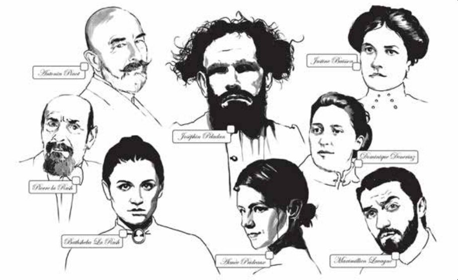

**Описание:** потрясающе привлекательна, с ниспадающими чёрными волосами и тёмными глазами.

**Черты:** обаятельна.

**Зацепки для отыгрыша:**

- Сеять семена вдохновения везде, где только можно.

### Жюстин Бюиссон (хореограф), женщина, 38 лет

Жюстин прославилась как балерина. После многих лет на сцене она перешла к постановке балетов по всей Франции. Её спектакли горячо любят и публика, и критики.

По просьбе Пеладана Бюиссон вместе с Денерьяз (см. ниже) подготовила серию выступлений, шедших на протяжении всего Салона. Обе художницы — независимые натуры и не считают, что их искусству нужна поддержка трудами другой. Однако их совместная работа оказалась поистине потрясающей.

Бюиссон ставит танцы, которые дополняют сопровождающую их музыку, но в конечном счёте рассказывают свою собственную историю. Она мечтает создать произведение такого же размаха и рассказать его языком танца, а не музыки.

**Описание:** стройная, волосы подобраны, платье с высоким воротом, в волосах неброские ленты.

**Черты:** сдержанная манера держаться.

**Зацепки для отыгрыша:**

- Независимая женщина, уверенная в своих способностях и с надеждой смотрящая в будущее.
- Всеми силами избегает Денерьяз — и её общества, и разговоров с ней.

### Доминик Денерьяз (музыкант), женщина, 35 лет

Доминик была музыкальным вундеркиндом и уже много лет известна в художественных кругах Парижа. Она родилась в старинной богатой семье, с юных лет развивавшей её талант, и никогда ни в чём не нуждалась. Успеха она добилась задолго до того, как вступила в Салон, — а вступила прежде всего потому, что это было что-то новое и интересное, нечто способное, возможно, бросить ей вызов. Этот опыт и правда оказался непростым, но не так, как ей хотелось. Вступив в Салон, своим талантом она заслужила место в Мистическом ордене Розы и Креста.

Как сказано выше, по просьбе Пеладана её поставили в пару с Бюиссон. Особый талант Денерьяз в том, что она пишет музыку, подогнанную под акустику зданий, где её исполняют. Её работы отличаются почти научной точностью и захватывают на глубинном, чувственном уровне.

Денерьяз возмущена, что её поставили в пару с Бюиссон: как и её напарница, она считает, что её работе не нужна поддержка чужим трудом.
