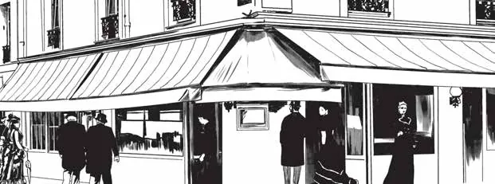

(никто из названных персонажей Хранителя) — пока в дверь, пошатываясь, не входит Пино. Он пробирается к своему другу Кловису Эрберу (готовому сыщику) и напрашивается на стаканчик. Глаза у него налиты кровью, он бледен, на лбу пот. Он объясняет, что у него ужасно болит голова и он боится, что не сможет пробыть на вечеринке Пеладана до конца, но ненадолго всё же придёт: от него этого ждут. После нескольких рюмок ему становится немного лучше.

Если с Пино заговорить, он упомянет, что Ла Раш должен был работать над скульптурой минотавра к его картине «Человек и бык», но так и не закончил её, потому что встретил свою новую жену и у них случился бурный роман. Ещё он расскажет, что Ла Раш и прекрасная Вирсавия навестили его два вечера назад (в пятницу вечером), после закрытия галереи, и извинились за то, что скульптура не закончена. Пино это не слишком огорчило: так его работа выставлялась сама по себе (и все похвалы достались ей).

Под конец он заметит, что какие-то слова Вирсавии вдохновили его на следующую работу. Он упорно трудится над картиной — феникс, восстающий из пепла. Возможно, его нынешний недуг вызван тем, что последние пару дней он работал слишком много, не щадя себя.

Если кто-то из сыщиков, ищущих признаки трений в Салоне (то есть Бенуа, Эно и Рошфор), попробует что-то выведать у Пино, он не захочет подтверждать никаких подробностей, но после успешной проверки социального навыка (например, **Обаяния**, **Убеждения**, **Красноречия**) заметит, что они спрашивают не того человека. Если хотят узнать больше, скажет он, пусть расспросят тех, кто больше его «склонен к музыке».

В 8 часов вечера мимо абсентной катят экипажи — к дому Пеладана. Другие гости абсентной начинают расходиться: для сыщиков это знак отправляться на вечеринку.

> **Раздатка «Послание» 1**
>
> **Место действия**
>
> Воскресенье, 10 апреля 1892 года. Париж, Франция. *Прекрасная эпоха* — время мира по всей Европе, когда научные открытия и технические достижения совершаются среди рождающихся художественных течений. В Париже искусства процветают.
>
> Салон Розы и Креста — новый салон искусства и музыки, который устроил Жозефен Пеладан. Салон шёл с 10 марта по 10 апреля 1892 года; центром выставки была галерея Дюран-Рюэля на улице Ле Пелетье, 11, в IX округе Парижа. В округе несколько галерей и оперных театров; это бьющееся сердце художественной жизни города.
>
> Салон Розы и Креста вырос из Мистического ордена Розы и Креста — тоже создания Пеладана. Мистический орден — религиозное, почти культовое движение, созданное в Париже после того, как Пеладан покинул мартинистский орден (Каббалистический орден Розы и Креста). Большинство художников Салона — живописцы, писатели и композиторы-символисты, как раз входящие в силу.
>
> Сам Пеладан — известный художественный критик, превозносящий художников, которые обращаются к мифам, снам и аллегориям. Суть учения Пеладана — искусство должно быть эзотерическим. Он надеется, что эта новая волна искусства однажды одолеет то, что он считает «европейским материализмом», воплощённым влиятельными художниками Академии изящных искусств, которые по-прежнему поддерживают импрессионизм. Салон Розы и Креста — средство, которым он надеется воплотить эту мечту.

