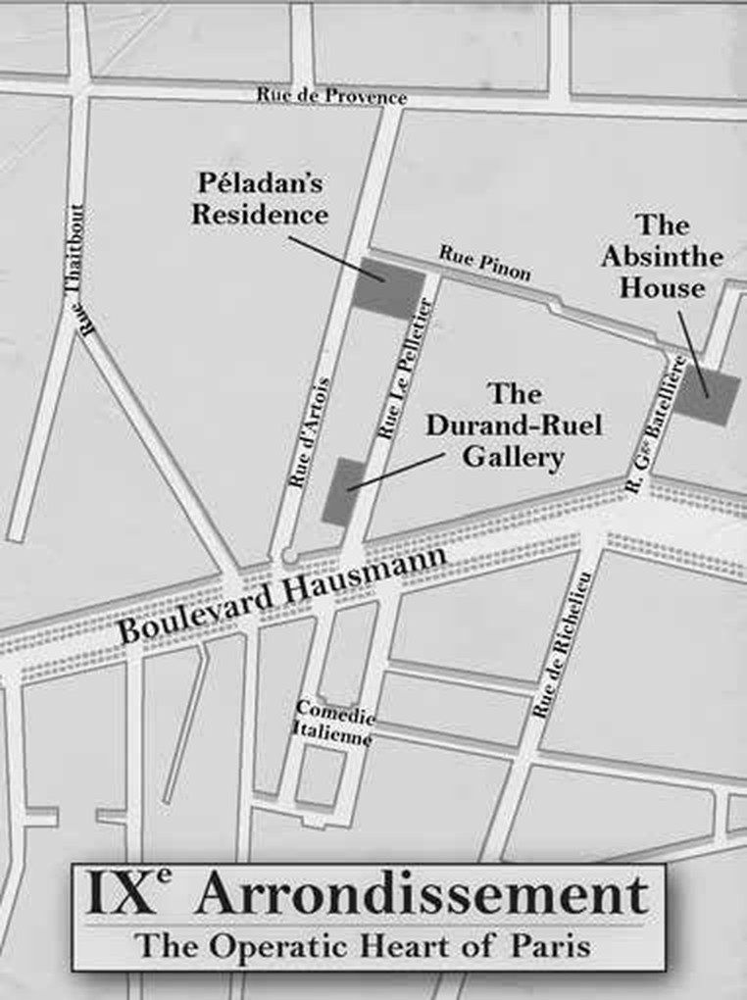

Подписи карты: **IXe Arrondissement — The Operatic Heart of Paris** — IX округ — оперное сердце Парижа; Péladan’s Residence — дом Пеладана; The Absinthe House — абсентная; The Durand-Ruel Gallery — галерея Дюран-Рюэля; Comédie Italienne — Комеди Итальен; Rue de Provence — улица Прованс; Rue Pinon — улица Пинон; Rue Thaitbout — улица Тетбу; Rue d’Artois — улица д’Артуа; Rue Le Pelletier — улица Ле Пелетье; R. Gge Batellière — улица Гранж-Бательер; Rue de Richelieu — улица Ришельё; Boulevard Hausmann — бульвар Осман.

## Сцена 2. Дом Пеладана

### Прибытие и встреча

Улица Пинон — узкая улица, идущая параллельно бульвару Осман, одной из главных дорог IX округа. Вход в дом Пеладана — большие резные деревянные двери под нарядным портиком. Само здание в четыре этажа, с двумя маленькими балконами, выходящими на улицу.

Когда сыщики подходят, у парадной двери останавливается чёрный конный экипаж. Через несколько секунд из него выходят Ла Раш и Вирсавия. Хранителю стоит подчеркнуть её потрясающую красоту и то, как к ней приковываются все взгляды. На пальце у неё перстень с крупным бриллиантом; чрезвычайный успех в проверке Оценки подтвердит, что это скорее кварц, чем бриллиант.

В этот миг Бенуа (готового сыщика) охватывает чувство дежавю, будто он уже где-то встречал Вирсавию. Попросите игрока Бенуа пройти проверку **ИНТ**: при чрезвычайном успехе Бенуа вспоминает её лицо по картине Пино «5 000», которая всё ещё выставлена в галерее (см. с. 61) и о которой он несколько месяцев назад писал рецензию. Провал означает, что лицо ей кажется как-то знакомым, но вспомнить, откуда, не удаётся. Если спросить Пино о картине, он скажет, что сам придумал этот образ, пытаясь запечатлеть самую прекрасную женщину, какую мог вообразить. Сходство этих двух — поразительное совпадение, и он не задумывался о нём, пока сыщик не заговорил об этом.

Дворецкий у дверей, Фабиан Коффье, принимает приглашения у входящих персонажей и сыщиков. Каждому он сообщает, что хозяин, месье Пеладан, вскоре к ним присоединится. Гости могут свободно располагаться на первом этаже — в большом вестибюле, в гостиной или в библиотеке. Задняя часть дома, комнаты прислуги и кухни закрыты для гостей, как и спальни и личные комнаты на верхних этажах.

Когда входит Эдвина Александер (готовый сыщик), Коффье также тихо говорит ей, что Пеладан велел передать: он занят — совершает обряд в галерее. Чтобы подслушать это, другим сыщикам нужна успешная проверка **Слуха**. Если к 10 часам вечера Пеладан не вернётся домой, её приглашают присоединиться к нему в галерее. Другие гости могут пойти с ней, если она сочтёт нужным.

### Перемещения персонажей Хранителя

На вечеринке тридцать гостей — множество художников, музыкантов, покровителей искусств и почётных гостей Салона, а также шесть горничных в парадной форме, разносящих вина на серебряных подносах. Называть их всех значит завалить сыщиков ненужными сведениями, но Хранитель может придумать нескольких второстепенных лиц.

Хранителю стоит помнить о зацепках для отыгрыша персонажей и вести их так, чтобы история и общение были как можно интереснее, при необходимости назначая проверки социальных навыков (**Красноречие, Обаяние, Запугивание** или **Убеждение**).

### Антонен Пино

Войдя в вестибюль, Пино радостно приветствует Ла Раша и Вирсавию. Он объясняет, что уже усердно работает над следующим творением — благодаря Вирсавии, которая в ответ тепло улыбается. Через несколько мгновений Пино
