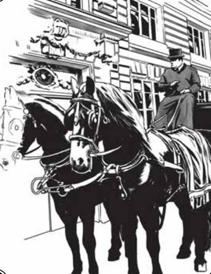

чувствует себя плохо и хватается за голову. Через силу улыбнувшись, он говорит, что уйдёт в библиотеку. Там он и остаётся большую часть вечера, но охотно говорит с любым, собрав всё обаяние, на какое способен. Почему Пеладан опаздывает, он понятия не имеет.

### Эме Придо

Придо проводит большую часть времени в библиотеке на первом этаже, где собраны внушительные справочники, современная и классическая художественная литература, но нет ничего эзотерического (такие тексты — наверху, в оккультной библиотеке). Она охотно говорит о Салоне, хотя не верит, что между художниками есть какие-то трения. Проверка **Психологии** подтверждает, что она говорит правду — насколько её знает. Ещё сильнее подчёркивая свою ненаблюдательность, она говорит, что надеется, что Пино и Ла Раш не рассорятся из-за того, что скульптор не представил свою работу в Салоне. Очевидно, она не слышала, как эти двое приветствовали друг друга в вестибюле.

Если расспросить её, где может быть Пеладан, она скажет, что слышала, как он говорил, что ещё побудет в галерее с несколькими членами Мистического ордена, — он беспокоился и хотел убедиться, что Салон окажется успешным. Она может лишь повторить слова Пеладана и может только гадать об их истинном смысле. Однако она знает, что Пеладан время от времени совершает обряды — это часть практик Мистического ордена. Наконец, как член Мистического ордена, она может подтвердить, кто из присутствующих гостей тоже состоит в нём (Пеладан, она сама, Денерьяз и с недавних пор Ла Раш).

Если она заметит что-то, что её заинтересует, или когда Вирсавия посадит в неё семя вдохновения, она уходит в сторонку, садится и записывает свои мысли в блокнот.

### Жюстин Бюиссон

Бюиссон проводит время то в вестибюле, то в библиотеке — после того, как Денерьяз садится у фортепиано в гостиной. Она приветлива и готова обсуждать любую тему, какую захотят затронуть сыщики, но не хочет говорить о своей совместной работе с Денерьяз. Если настаивать, она скажет, что этот опыт был интересным и в чём-то поучительным, но ей гораздо больше нравится работать одной.

В целом она вежлива в ответах и до известной степени дипломатична, но не скрывает, что они с Денерьяз не ладят. Бюиссон ничего не знает о том, почему Пеладан опаздывает на вечеринку.

### Доминик Денерьяз

В отличие от Бюиссон, Денерьяз открыто показывает неприязнь к своей напарнице по искусству. Она садится у фортепиано в гостиной и с самого начала выразительными взглядами ясно даёт понять, что Бюиссон в одной с ней комнате не рада.

Она грубо пропускает мимо ушей любые замечания, где упоминается Бюиссон: либо резко меняет тему, либо перебивает собеседника, чтобы подтвердить своё превосходство над хореографом.

### Максимильен Лавань

Первую часть вечера Лавань проводит в вестибюле, в основном держась особняком. Когда приходят сыщики, он заводит свои карманные часы и сверяет их с напольными часами напротив подножия лестницы. Закончив, он замечает Памелу Гийон — подкупленную им горничную, которая выходит из кухни с подносом напитков. Трудная проверка **Внимания** позволяет заметить, что они слегка кивают друг другу, прежде чем Лавань уходит в гостиную, где время от времени выпивает. Хранителю стоит учесть последовательность событий в разделе **«Подставить Придо»** (с. 58).

Он охотно говорит, превознося собственные работы, но его настроение немного портится при упоминании Мистического ордена, а точнее Придо. Он может подтвердить, кто из присутствующих художников состоит в ордене (Пеладан, Придо, Денерьяз и с недавних пор Ла Раш).

Если выпытывать у него сведения, он может упомянуть ссору Бюиссон и Денерьяз, а заодно воспользуется случаем очернить Придо. Подставив её, он посоветует сыщикам приглядывать за ней: из надёжного источника, от одного из слуг Пеладана, он знает, что она собирается украсть несколько книг из оккультной библиотеки Пеладана наверху.
