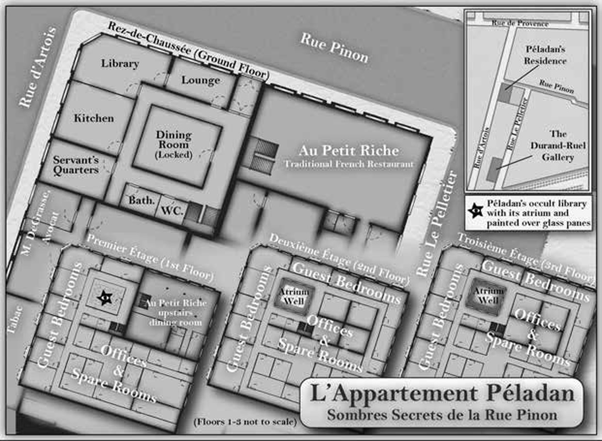

Подписи плана: **L’Appartement Péladan — Sombres Secrets de la Rue Pinon** — дом Пеладана: мрачные тайны улицы Пинон (этажи 1–3 не в масштабе).

- **Rez-de-Chaussée (Ground Floor)** — первый этаж: Library — библиотека; Lounge — гостиная; Kitchen — кухня; Dining Room (Locked) — столовая (заперта); Servant’s Quarters — комнаты прислуги; Bath., W.C. — ванная, уборная.
- **Premier Étage (1st Floor)** — второй этаж: Guest Bedrooms — гостевые спальни; Offices & Spare Rooms — кабинеты и запасные комнаты; Au Petit Riche upstairs dining room — верхний обеденный зал ресторана «О Пти Риш»; звезда — оккультная библиотека Пеладана.
- **Deuxième Étage (2nd Floor)** и **Troisième Étage (3rd Floor)** — третий и четвёртый этажи: Guest Bedrooms — гостевые спальни; Offices & Spare Rooms — кабинеты и запасные комнаты; Atrium Well — колодец атриума.
- Соседи и улицы: Au Petit Riche, Traditional French Restaurant — ресторан «О Пти Риш», традиционная французская кухня; M. DeGrasse, Avocat — контора адвоката М. Деграсса; Tabac — табачная лавка; Rue Pinon — улица Пинон; Rue d’Artois — улица д’Артуа; Rue Le Pelletier — улица Ле Пелетье.
- Врезка: Rue de Provence — улица Прованс; Péladan’s Residence — дом Пеладана; The Durand-Ruel Gallery — галерея Дюран-Рюэля; звезда — оккультная библиотека Пеладана с атриумом и закрашенными стёклами.

### Пьер Ла Раш и Вирсавия

Ла Раш пришёл на вечеринку, чтобы вернуть Пеладану его экземпляр «Évocations du Dieu intérieur» и извиниться за то, что не смог закончить скульптуру минотавра к Салону. Он собирается на вечеринке раньше, чем всему остальному миру, открыть Пеладану природу Вирсавии: Пеладан оценит величие его свершения на куда более глубоком, эзотерическом уровне. Заодно Ла Раш хочет восстановить их отношения после своей неудачи с Салоном.

Когда сыщики впервые входят в вестибюль, Хранителю стоит попросить их пройти проверку **Удачи**. Провал означает, что с этими сыщиками Вирсавия заговорит в течение вечера (см. **«Семена вдохновения»**, с. 46). Если сыщики, прошедшие проверку Удачи, сами решат заговорить с Вирсавией, они тоже рискуют получить семя вдохновения.

Ла Раш (кроме того раза, когда он пойдёт возвращать «Évocations du Dieu intérieur» в оккультную библиотеку, см. ниже) ходит за Вирсавией и в разговорах держится на вторых ролях. Пока его жена говорит, он охотно угощается напитками, которые предлагают горничные, понемногу хмелеет и становится разговорчивее. Если кто-то из сыщиков проявит интерес к его работам, он пригласит их в следующие дни побывать у него в доме в Туари.

Вирсавия подтвердит, что они с Ла Рашем недавно познакомились и поженились после бурного романа. В остальном она уклончива в подробностях о себе. Если настаивать на ответах, она может потом, в разговоре с другими, сама себе противоречить.

Когда находят мёртвого Пино, Ла Раш и Вирсавия уходят первыми.

Вирсавия непременно заговаривает с каждым из названных персонажей Хранителя и с каждым сыщиком, провалившим проверку Удачи. Поговорив и выведав их надежды и мечты, она наклоняется к собеседнику и шепчет вдохновляющую фразу. Наблюдатели издали при успешной проверке **Психологии** могут понять, что её слова глубоко действуют на тех, кто их слышит. Поговорив потом с каждым персонажем, можно убедиться, что их охватил новый порыв вдохновения.

Всякий, кто слышит вдохновляющую фразу, сказанную другому (то есть намеренно подслушивает, пройдя трудную проверку **Слуха**), тоже должен провалить проверку ИНТ, чтобы избежать вдохновения. Если в нём уже посажено семя вдохновения, второго посадить нельзя, и проверка не нужна.

Ниже — что говорит Вирсавия каждому сыщику и персонажу, чтобы вдохновить их:

**Жюстин Бюиссон:** «Чтобы рассказать историю, не нужны слова. Некоторые истории, некоторые понятия словами не выразить».

Бюиссон вдохновляется создать танец, передающий чувства языком танца.
