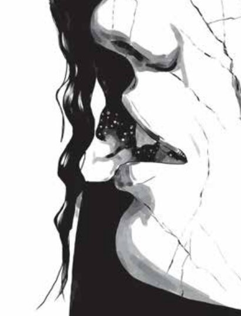

**Доминик Денерьяз:** «Музыка во многом похожа на язык, не находите? Говорят, у всех языков общий корень — язык, от которого произошли все остальные… Интересно, нет ли всеобщей мелодии, от которой изначально пошла вся музыка».

Вирсавия подталкивает Денерьяз искать эту всеобщую мелодию — ряд звуков, на котором построены все прочие звуки.

**Максимильен Лавань:** «Как вы стремитесь походить на других, так пусть другие стремятся походить на вас. Если вы обессмертите великих в своих трудах, то и вас обессмертят те, кто захочет пойти по вашим стопам».

Лавань принимается изображать романтиков и готических рассказчиков, делая их самих произведением искусства.

**Эме Придо:** «Возрождение черпало вдохновение в Библии. Зачем довольствоваться одной фигурой, если в центре вашего цикла могут быть двенадцать?»

Вирсавия предлагает ей сложить двенадцать сонетов — по одному на каждого из апостолов.

**Эдвина Александер (готовый сыщик):** «Человечество, как и дом, строилось снизу вверх. Ответы, которые вы ищете, лежат на дне нашего мира».

На следующую ночь Эдвину захватывают сны, в которых она летит сквозь холодный, леденящий воздух между горами, вздымающимися так невозможно высоко, что, кажется, пронзают само небо. Обогнув одну гору, она видит огромный город, раскинувшийся перед ней в ледяной пустыне. Эдвина видит Город Старцев. Чтобы семя вдохновения проросло и она спаслась, ей нужно нарисовать то, что она видит во снах.

**Джейн Харнсворт-Райт (готовый сыщик):** «Ни у кого нет исключительного права писать быка, и не один лишь человек может писать маслом. Он открыл дверь — неужели вы не шагнёте в неё и не создадите собственную работу в его манере?»

На следующую ночь Джейн с трудом засыпает. Лёжа в постели, она представляет, как всё вокруг выступает из темноты — как на картине Пино. Её охватывает вдохновение нарисовать увиденное, добиваясь похожего эффекта разными оттенками и штриховкой, и изобразить на бумаге окружающий её мир в полной темноте.

**Кловис Эрбер (готовый сыщик):** «Ваша работа должна быть не только как можно более жизненной — она должна быть о жизни. Запечатлейте миг, когда начинается жизнь, и покажите его миру во всей его славе».

Той ночью Кловиса преследует во снах образ рождения ребёнка. Он видит мать с новорождённым на руках и вдохновляется перенести этот образ на холст.

**Рене Рошфор (готовый сыщик):** «Лучшие писатели пишут о том, что знают. Что мешает вам писать художественную прозу на основе фактов, о которых вы сообщали в газете?

А что насчёт того, что происходит здесь и сейчас?»

Той ночью Рене снова и снова видит во снах картины с вечеринки. Его тянет записать их прозой, сложив рассказ из событий вокруг Салона и вечеринки.

**Донасьен Бенуа (готовый сыщик):** «Вы порицаете тех, чьё искусство считаете низшим. А что вы считаете самой истинной, самой чистой формой искусства? Просветите тех, кто смотрит на вас снизу вверх, — и, возможно, сами обретёте ещё большее просветление».

Той ночью сны Донасьена наполнены образами произведений, на которые он писал рецензии для Салона, и сосредоточены на том, что такое совершенное искусство. Утром Донасьен может снова пройти проверку ИНТ, чтобы понять, где видел Вирсавию раньше, — на этот раз достаточно обычного успеха. Так Донасьен вдохновляется написать статью, где рассуждает о том, что считает чистейшей формой искусства, и пытается убедить читателя в своей правоте.

**Вивиан Эно (готовый сыщик):** «Сегодня мы видели, что даже грозящие взорваться ссоры можно уладить. Пино простил моего мужа за то, что тот не сумел закончить своего минотавра… Может быть, вы закончите его вместо него? Это залечило бы разлад не одними только словами».

Той ночью Вивиан преследуют во снах видения минотавра, гонящегося за ней по тёмному лабиринту. Сны тревожные, но вдохновляют яркостью подробностей, с которыми ей видится чудовище. Так Вивиан вдохновляется создать скульптуру минотавра.
