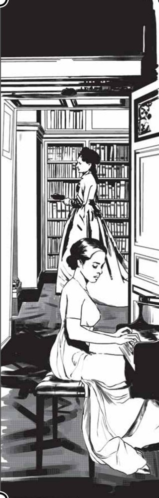

### Ла Раш и оккультная библиотека Пеладана

Вскоре после того, как все сыщики пришли и перешли в вестибюль, успешная проверка **Внимания** позволяет заметить: пока дворецкий Коффье повторяет ту же речь новым гостям, Ла Раш оставляет Вирсавию, похлопывает по чему-то твёрдому и прямоугольному у себя в кармане и поднимается из вестибюля по лестнице.

Ла Раш поднимается на следующий этаж и ключом, который ему дали (как и всем членам Мистического ордена), открывает оккультную библиотеку Пеладана. Там он оставляет экземпляр «Évocations du Dieu intérieur» и возвращается на вечеринку вниз.

В остальное время оккультная библиотека всегда заперта. Это квадратная комната в самой середине здания, без окон. Она освещена газовыми лампами, и все её стены заставлены огромным множеством книг, многие из которых очень стары и ценны. Лестницы ведут на узкий балкон, идущий вокруг всей комнаты, — с него можно дотянуться до верхних полок. По комнате расставлены кожаные кресла и столы для чтения, у каждого своя лампа. Вход в библиотеку только один.

В дальнем конце комнаты, напротив двустворчатых дверей, стоит стеклянный шкаф. Он заперт, но на его полках видны несколько чрезвычайно старых томов. Проверка **Оценки**, **Оккультизма** или **Мифов Ктулху** подтвердит, что это самые ценные книги собрания. Большинство томов — оккультные тексты (например, «Ключ Соломона», «Malleus Maleficarum», «Зоар» и т. п.), но есть и книги Мифов (экземпляры «Cultes des Goules», De Vermiis Mysteriis и «Пнакотических манускриптов»). Ключ от стеклянного шкафа есть только у Пеладана. Обычно «Évocations du Dieu intérieur» возвращали бы в этот шкаф, но у Ла Раша ключа нет, и он просто оставляет книгу на ближайшем к шкафу столе, у всех на виду.

### Как подняться наверх

Если сыщики захотят подняться наверх, главное препятствие для них — дворецкий Коффье. Чтобы подняться по лестнице незаметно для него, нужна трудная проверка **Скрытности**. Впрочем, пока он представляет собравшимся новых гостей (а это происходит так часто, как пожелает Хранитель), чтобы остаться незамеченным, хватит обычного успеха. Та же проверка нужна, чтобы незаметно вернуться в вестибюль. Провал означает, что их заметил Коффье или, если уместно, другой гость.

Если Коффье заметит, что кто-то из сыщиков пытается подняться по лестнице, он вежливо окликнет его и напомнит, что верхние этажи закрыты для гостей. Если его не послушают, он ещё раз предупредит, что так настоятельно распорядился хозяин, а если сыщики снова не подчинятся, Коффье вызовет жандармерию. Это не
